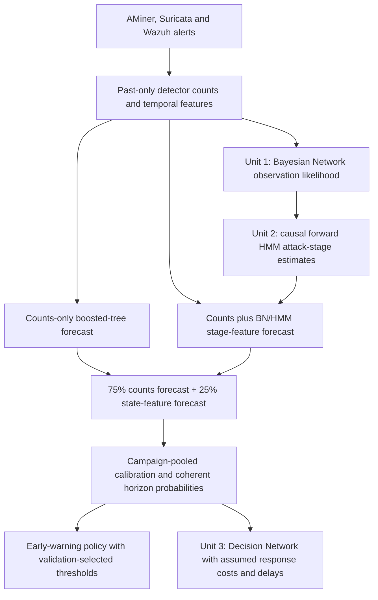

# MIS5 — Probabilistic Cyberattack Early Warning

MIS5 studies whether combining network and host alerts with probabilistic attack-stage estimates can give useful warning **before a specified harmful outcome occurs**. We also study how those forecasts can support response decisions under explicit delay and cost assumptions.

Our current focus is **30-minute early warning of successful privilege escalation**, evaluated on eight AIT campaigns. Earlier malicious activity can already have happened: the forecast concerns the next defined outcome, rather than predicting the first malicious action from benign activity alone. Earlier DARPA experiments examine DDoS launch separately.

## What we are trying to achieve

- Estimate future-outcome probabilities using only information available at prediction time.
- Combine complementary sensor evidence and inferred attack progression.
- Measure timely warnings, false alarms, probability error and warning lead time against matched baselines.
- Recommend a response using modeled expected loss, including response delay and disruption cost.
- Build an auditable empirical study that can support a research paper, with all positive and negative findings retained.

## Current pipeline



The frozen research preset is **pooled-calibrated fixed .25 state fusion**. It forecasts at 1, 2, 5, 10, 15 and 30 minutes, using the same blend across all horizons. Availability-specific experts omit unavailable sensor inputs; no available sensors means abstention. The Decision Network recommends an action but does not execute a defense.

| Syllabus unit | Included concept | Role in this version |
|---|---|---|
| Unit 1 | Bayesian Network inference | Observation likelihood for latent attack stages, omitting unavailable evidence. |
| Unit 2 | Hidden Markov Model | Forward filtering and past-only summaries of attack-stage beliefs. |
| Unit 3 | Decision Network | Expected-loss comparison of response choices from calibrated onset forecasts. |

See [the current-version specification](docs/CURRENT_VERSION.md) and [frozen artifacts](experiments/current_version/README.md). Further model advancements are deferred for now.

## What the experiments show

For the 30-minute successful-root endpoint, with thresholds chosen under the same validation budget of one false episode per 24 negative hours and at most five negative warning minutes:

| Test metric | Original calibrated counts baseline | Current preset |
|---|---:|---:|
| Timely new warnings | 4/8 campaigns | 5/8 campaigns |
| Mean Brier score (lower is better) | 0.0015254 | 0.0014606 |
| Mean average precision (higher is better) | 0.8320 | 0.8275 |
| False alarm episodes on test campaigns | 19 | 5 |

These are **conditional gains**, not overall superiority. The false-alarm reduction is dominated by one campaign and reverses when that campaign is removed. Matched pooled-calibrated counts produces 3/8 timely warnings and one false episode, so adding stage information also adds alarm burden. At 15 minutes, the current preset is worse on probability error than the original counts baseline. External CAM transfer produces 0/3 warnings at 15 and 30 minutes.

The preset was chosen after inspecting these results; it is a development choice, not an independent confirmation. Architectural novelty, superiority over complete published systems and publication acceptance remain unestablished. Response effects are assumed, rather than demonstrated through deployed interventions.

Read the [full selective-fusion comparison](experiments/selective_fusion/REPORT.md), [publication validation report](experiments/publication_validation/REPORT.md), [novelty audit](docs/NOVELTY_AUDIT.md) and [paper draft](docs/PAPER_DRAFT.md).

## Repository layout

| Path | Contents |
|---|---|
| `backend/research/` | Causal forecasting, calibration, comparisons, verification and report scripts. |
| `backend/app/` | FastAPI research dashboard API and earlier demonstration backend. |
| `backend/tests/` | Model, ingestion, causality, endpoint and forecasting regression checks. |
| `frontend/` | React, TypeScript and Vite dashboard for verified results and campaign replay. |
| `experiments/current_version/` | Frozen preset, 59 prediction archives, fold calibrators, thresholds and verification. |
| `experiments/` | Protocols, reports, score tables and previous model comparisons. |
| `docs/` | Research scope, current specification, literature audit and manuscript material. |
| `data/README.md` | Instructions for obtaining local dataset inputs. |
| `third_party/pard_ssm/` | Pinned author-code audit material, retaining its original license and source manifest. |

The default dashboard reads the current frozen AIT forecasts, campaign scores and comparisons directly. It supports 15-/30-minute comparisons, seven sensor configurations, pre-outcome campaign replay, six-horizon risk inspection, modeled response recommendations and plot downloads. Replay does not retrain models or execute defenses. The earlier DARPA/synthetic phase-classification interface remains accessible through **Earlier demo**; its outputs are separate from the verified research results.

## Implemented operational improvements

The 30-minute streaming extension now defaults to **responsive warnings**, keeping
the original forecast probabilities, threshold coverage and first-alert timing.
An explicit **confirmed** profile reduces false episodes from **5 to 2** on the
eight archived campaigns, with **5/8** timely coverage and **14 to 8** notifications,
but can delay warnings. It is optional because the same profile lowers 15-minute
coverage from 4/8 to 3/8.

The runtime updates sensor histories while evaluating only the selected expert.
A paired 180-observation check measures inference computation with identical
predictions. The [current release report](experiments/operational_improvements/CURRENT_RELEASE.md)
records the final median reduction and HTTP latency, including the costs of
validation and rollback protection. These are local measurements, not production
guarantees; older separate runs are retained for comparison.
Eleven validation-selected warning candidates were evaluated; the selector had
lead-time regressions and was not promoted to the live default.

Missing-sensor comparisons improve Brier error in five of six induced outage
settings on the fox fold, with a slight regression for Suricata alone. These
compare existing sensor experts with a naive zero-fill comparator; automatic
streaming routing is new, while the trained experts are unchanged. These are
exploratory results, not a new trained-model gain.
The local response test records acknowledgments and a no-op handler; actual
attack prevention has not been measured. The overview dashboard shows the new
policy comparison alongside the historical frozen results.
The production deployment and defensive-effectiveness part remains outstanding.

See the [current verified release](experiments/operational_improvements/CURRENT_RELEASE.md),
[confirmed-profile study](experiments/operational_improvements/REPORT.md)
and [streaming setup/API runbook](docs/OPERATIONAL_IMPROVEMENTS.md).

## Improvements report

Read the [15-page improvements PDF](reports/MIS5_Improvements_Explained.pdf)
for what changed, why it was needed, how it works, measured results and remaining
tradeoffs. The [HTML version](reports/MIS5_Improvements_Explained.html) and
[report builder](reports/build_improvements_pdf.py) are included as well.
Repository attributes preserve exact file bytes so the recorded evidence hashes
remain valid across checkouts.

## Setup

The recorded Python environment used **Python 3.14.2**. From the repository root, create an environment and install the backend and research dependencies:

```powershell
python -m venv .venv
.\.venv\Scripts\Activate.ps1
python -m pip install -r backend/requirements.txt -r backend/research/requirements-research.txt
```

The research requirements include PyTorch for the GRU comparison and regression checks. Dataset archives, downloaded telemetry, the local SQLite database, dependency folders and intermediate fitting caches are excluded from Git. Obtain the inputs as described in [data/README.md](data/README.md) before running data-dependent scripts.

### Review or verify the research version

The existing reports and frozen results can be read immediately. With the prepared AIT inputs available locally:

```powershell
python -m unittest discover -s backend/tests -v
python backend/research/verify_current_version.py
```

The original frozen-package verification passed **33 tests**. Its refitted full-sensor fox forecast matched the archived predictions exactly, including the causal-prefix check. See [verification.json](experiments/current_version/verification.json). Current checks cover **95 backend tests**, all **56 sensor experts**, **2,007,012 forecast values**, **25,440 score rows** and **8,064 validation-grid threshold optima**, recorded in [operational verification](experiments/operational_improvements/verification.json). These establish implementation and arithmetic properties on retained evidence, not a new held-out experiment or global model optimality.

To rebuild the frozen package from the retained selective-fusion outputs:

```powershell
python backend/research/freeze_current_version.py
```

This copies the chosen artifacts and refreshes their hashes without training or tuning. Historical reproducibility manifests describe the full local research workspace; checks involving excluded datasets or intermediate caches require those inputs to be restored.

### Run the demonstration dashboard

Start the API from the repository root:

```powershell
python -m uvicorn app.main:app --app-dir backend --reload --port 8000
```

In a second terminal:

```powershell
cd frontend
npm ci
npm run dev
```

Open `http://127.0.0.1:5173`. The frontend uses Vite's `/api` proxy to the local backend; API documentation is available at `http://127.0.0.1:8000/docs`. The research dashboard uses the published JSON/NPZ artifacts and does not require raw datasets. Plot downloads additionally use `Plots/Results/mids`, generated with `python Plots/create_mids_plots.py`. For the **Earlier demo**, use its synthetic scenario generator without DARPA archives, or populate DARPA scenarios by placing the two original archives at the repository root and running `python backend/run_ingestion.py`.

The API is limited to local loopback clients and declared local browser origins.
Dashboard evidence is checksum-checked before cache access, using the frozen
manifest and `experiments/operational_improvements/metrics_verification.json`.
Earlier-demo replay now uses independent causal batches; its simulations use
assumed model units. Cached legacy experiment reports may predate those fixes
and are explicitly labeled. See the runbook for retries, outage handling,
receipt timing and reproduction of the stress and browser tests.

## Research status and attribution

The current version is frozen for an exploratory 30-minute early-warning study. Earlier baselines, unsuccessful variants and evaluation limitations remain visible. Stronger claims require fresh independent campaigns and evidence about real response effects.

Original datasets retain their publishers' terms; links and provenance are recorded in [the data guide](data/README.md) and research reports. The vendored PARD-SSM audit subset retains its [Apache-2.0 license](third_party/pard_ssm/LICENSE) and [source manifest](third_party/pard_ssm/SOURCE_MANIFEST.json). No license for the project's own code has been selected yet.
