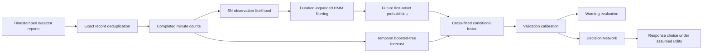
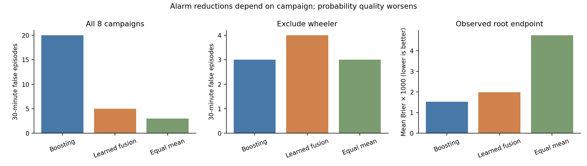

# Forecasting Privilege Escalation from Multi-Sensor Alerts: Endpoint Validation and Warning–Probability Tradeoffs

Manuscript draft, 4 October 2026. Author names, affiliations and submission
format remain to be supplied. This draft describes the executed research engine,
not the legacy application demonstration. Results are exploratory.

## Abstract

Forecasting a harmful cyberattack outcome requires evidence that an alert
precedes that outcome and a distinction between forecast probability quality
and operational warning performance. We evaluate established probabilistic and
supervised methods on eight AIT alert campaigns using completed minute bins,
campaign-separated fitting and validation, and six first-onset horizons.
Original attacker logs and attack-labelled victim audit records confirm
successful changes from a web-service identity to a system user in all eight
campaigns, within 0.779–2.403 seconds of the scheduled escalation. Separately
verified root sessions permit a stronger endpoint sensitivity analysis. A
multi-sensor temporal boosted-tree model reduces mean 15-minute Brier error by
30.3% relative to the best single-sensor tree. Conditional fusion of a
duration-aware hidden Markov forecast and the tree reduces 30-minute false
episodes from 20 to 5 while retaining timely new warnings in 4/8 root cases.
However, fusion worsens probability error, and excluding one campaign reverses
the alarm improvement. Fixed HMM and GRU adaptations provide additional
same-task comparisons. A subsequent availability-specific revision recovers
3/8 timely warnings with Wazuh absent through counts-only experts. Adding
cross-fitted BN/HMM stage features lowers full-input 15-minute timely coverage
from 4/8 to 2/8 and increases probability error. A separate probability-preserving
alarm revision selects no HMM confirmation at either main horizon, yielding no
additional state-model benefit. A further campaign-based calibration experiment
finds a prespecified fixed .25 state blend with 5/8 timely 30-minute warnings
and 4.25% lower Brier than original counts-only, but its aggregate false-alarm
gain remains campaign-dependent. The adaptive 15-minute selector fails its
warning-budget target. Frozen transfer to three eligible CAM-LDS templates with
missing sensor families produces no 15-minute warnings. An expected-utility
Decision Network illustrates response-delay sensitivity under assumed costs
and effects, without demonstrating attack prevention. The contribution is an
auditable empirical investigation of endpoint validity and conditional
forecasting tradeoffs; general superiority and architectural originality are
not established.

## 1. Introduction

An intrusion detector can recognize scanning, exploitation or authentication
activity after it has started. A forecaster instead estimates whether a
specified future outcome will occur within a meaningful amount of time. These
tasks differ even when they use identical alerts. Here the primary outcome is
the first privilege change in an ongoing multistep intrusion. We do not claim
to predict an attacker’s first action before any observable precursor exists.

Combining established methods can yield an empirical contribution, but an
unmatched pipeline name does not establish that contribution. Improvements
need to survive common data, information and outcome definitions. Furthermore,
an alarm that remains active for hours may overlap an outcome’s forecast window
without creating a useful new warning. A method can reduce such alarm burden
while making its probabilities worse.

We investigate three questions: whether multiple detector families improve
future-onset forecasts relative to individual families; whether combining a
duration model with direct supervised forecasts improves operational warnings;
and how endpoint verification, alarm definitions and missing sensors affect
these conclusions. Our contribution is the resulting reproducible evaluation
and its limitations. We introduce no new learning algorithm or general
Bayesian inference principle.

## 2. Related work and scope

Perera Miriya Thanthrige, Samarabandu and Wang [1] combine bag-of-words alert
representations, k-means clustering and an unsupervised HMM to forecast the next
alert cluster. Their projection starts from the last Viterbi state. Its
per-alert prediction target and accuracy differ from predicting a first outcome
within a clock-time horizon. Ansari, Bartoš and Lee [2] use GRUs to forecast
Warden alert sequences, likewise motivating a temporal neural comparator
without supplying directly comparable onset scores.

BN/HMM intrusion detection already appears in [7]; duration-sensitive
cybersecurity modeling appears in [8]. Decision Networks [9] and Bayesian
attack-graph mitigation [10] precede our expected-utility response component.
Our broader
[literature audit](NOVELTY_AUDIT.md) records these precedents and source-access
limits, including closely related multistep HMM and BN/HMM methods. Standard
stacking and age-expanded duration states are established techniques. We
therefore do not claim that BN + HMM + Decision Network, temporal forecasting,
calibration or fusion is a first-ever architecture.

We implement explicit adaptations of [1] and a GRU baseline inspired by [2].
Their input and target changes are documented below; these are not faithful
reproductions of the papers’ complete experiments. A recently withdrawn
deep/HMM preprint is excluded from validated accuracy comparisons [6].

## 3. Data, outcomes and available information

### 3.1 AIT alerts and successful outcomes

AIT-LDS [3] provides eight related simulations of an enterprise network and
multistep server takeover. AIT-ADS [4] contains alerts derived from those logs
using Wazuh, Suricata and AMiner. Our processing reads approximately 2.65 million alert records,
excludes AMiner training-mode records, deduplicates exact sensor record
identities, and retains detector-count observations up to 30 minutes beyond
the scheduled target. It does not classify an alert by ground-truth stage to
construct its input. Detector vocabularies, count thresholds and all learned
parameters are fitted without outer validation/test campaigns.

Inputs are counts of Wazuh rule identifiers, Suricata signature identifiers
and AMiner analysis-component identifiers in completed 60-second bins.
Unknown detector identifiers map to sensor-specific OTHER. Host identity,
attacker address, scenario filename and outcome timestamps are excluded from
features. Direct predictors additionally use past 5-, 15- and 60-minute means.

The original training target is the published start of privilege escalation.
We independently retrieved each campaign’s attacker execution log and the
victim intranet server’s audit log and published line annotations. A successful
attack-labelled USER_START session for `su` establishes the change from the
web-service account to a named system user; successful `sudo` sessions with
account root establish the later root endpoint. This distinction matters:
authentication as an ordinary system user is not identical to obtaining root.
Selected member hashes, audit line numbers and proof records are released in
the [endpoint evidence](../experiments/publication_validation/endpoint_evidence.json).
ZIP member CRCs and local SHA-256 hashes were checked; full archive checksums
were not verified because only selected members were retrieved.

Successful user changes occur 0.779–2.403 seconds after published onset, and
successful root sessions occur 12.056–27.243 seconds after it. Models and
thresholds remain frozen when rescored against observed endpoints. This is
sensitivity analysis of the original predictor, rather than retraining for a
new root-specific objective.

The dataset’s separate DNSteal attack deliberately begins at simulation start
[3, Section 3.2]; it is not a subsequent terminal step in the takeover chain.
We preserve its labels. Consequently, negative exposure means absence of the
specified impending privilege outcome, and can include other malicious
activity. It must not be interpreted as entirely benign traffic.

### 3.2 DARPA and external diagnostic

The available LLDOS `.tar.gz` archives supply full inside/DMZ captures rather
than only attack-labelled alerts. We parse 1,628,616 packets and use anonymous
protocol, port and cardinality counts. A separately implemented victim burst
rule determines first ACK-flood emission. The victim address is used only to
annotate this endpoint. XML phase-5 login starts precede actual flood emission
by approximately 96.15 and 92.76 seconds in the two variants. Two related
campaigns cannot establish broad generalization, and flood emission does not
establish that the victim suffered denial of service.

For additional transfer evidence, we selected one variant of each of six
distinct CAM-LDS templates [5] before scoring. We retrieved full Wazuh streams
and execution logs, not attack-filtered manifestations. Three templates have
an explicit executed privilege-escalation tactic; three lack that annotation
and are excluded from target recall. The eligible endpoint is an executed
tactic proxy, not an independently verified successful privilege change.
AMiner inputs are absent; Suricata alerts are present through Wazuh. The recordings have little
pre-outcome exposure. These cases constitute a separately reported domain and
missing-sensor diagnostic, not an equivalent full-sensor confirmation set.

### 3.3 Causal clock definition

For bin ending at t, only events timestamped at or before t contribute.
Temporal features and test-time state filtering are invariant to appending
future events. Training may use completed labelled fitting campaigns; test
forecasts cannot use future test observations. For target time T and horizon h,
the forecast label is `Y_h(t) = 1[t < T <= t + 60h]`, and scoring includes only
`t < T`. Ongoing target detection is excluded.

Clock causality depends on source timestamp availability. AIT-ADS is generated
forensically; excluding explicit detector training records does not establish
that all retained detectors were trained only on information available online.
We do not have a verified receipt-time trace or detector-training provenance
sufficient to prove a live warning lead. These are material deployment limits.

## 4. Pipeline and substantive syllabus components

### 4.1 Bayesian observation inference — Unit 1

The Bayesian Network has threat state S as parent of detector-count bucket
variables X_j. Laplace-smoothed conditional probability tables give
`L_t(s) = product_j P(X_tj = x_tj | S_t = s)`. Count bucket boundaries and
conditional tables use fitting campaigns only. Conditional independence of
detector variables given S is an approximation; exact replay deduplication
does not guarantee it. We compute one likelihood for temporal filtering,
rather than multiplying separately inferred BN and HMM posteriors.

### 4.2 HMM dynamics and first onset — Unit 2

Forward filtering gives
`b_t(s) ∝ L_t(s) sum_r A_rs b_(t-1)(r)`.
The duration variant expands intermediate attack stages into `(stage, age)`
states, with lognormal exit hazards fitted to stage durations. Benign waiting
remains geometric, and target entry is absorbing. This is standard
explicit-duration modeling represented as an expanded HMM.

For non-target indicator vector u, the first-onset forecast is
`p_h(t) = b_t^T (u - A^h u)`.
Posterior mass already in the target is excluded from future first arrival.
The evaluated horizons are 1, 2, 5, 10, 15 and 30 minutes. Static BN evidence
with the same projection, a geometric-duration HMM and the duration variant
are separate comparators.

### 4.3 Direct prediction and conditional fusion

Six boosted-tree classifiers predict the horizon labels from current and
trailing count features. We fix 100 iterations, learning rate 0.08, at most 15
leaves, minimum leaf size 20, L2 regularization 1 and seed 1729. Logistic
forecasting and current-only/single-sensor tree ablations provide additional
comparisons.

Conditional fusion is logistic stacking of the duration and tree log-odds:
`q_h = sigmoid(beta_0h + beta_1h logit(p_duration,h) + beta_2h logit(p_tree,h))`.
Within each six-campaign fitting set, two three-fit/three-predict splits supply
out-of-campaign base predictions for the fusion coefficients. The final base
models use all six fitting campaigns. Equal averaging is a simpler fusion
comparator. This conditional probability table interpretation is not a claim
of physical causation or novel stacking theory.

### 4.4 Decision Network — Unit 3

The network contains an onset-time chance node, an action decision, delayed
effectiveness and damage/disruption utility. Actions are Monitor, Restrict,
Block and Isolate, with assumed delays of 0, 2, 5 and 1 minutes, effectiveness
0, 0.45, 0.8 and 0.95, and disruption costs 0, 0.1, 0.5 and 2. For action a:

`ExpectedLoss(a) = c_a + D [p_30 - e_a max(0, p_30 - p_delay(a))]`.

We choose the action with smallest expected loss and compare with a policy
that ignores delay. Damage, effect and disruption are varied in 27 predefined
settings. Realized framewise costs in replay still use assumed action effects;
they are neither executed prevention nor cumulative sequential policy outcomes.

| Required unit | Included concept | Why it matters |
|---|---|---|
| 1 | BN conditional tables and inference | Converts detector evidence into a state likelihood |
| 2 | HMM filtering and duration states | Updates temporal belief and projects future onset |
| 3 | Decision Network and expected utility | Chooses an assumed response accounting for delay |

### 4.5 Availability-specific state-feature revision

A subsequent exploratory revision declares which of the three sensor families
are available and fits experts for all seven nonempty subsets. Count features
and BN observation likelihoods omit unavailable families. A declared empty
sensor set returns insufficient evidence rather than a risk estimate; an
observed zero count remains an observation. Current experiments use static
declared availability, without measured heartbeats or outage transitions.

The revised BN uses fitting-stage/count conditional tables. A geometric HMM
filters those likelihoods forward with a fixed likelihood power equal to the
inverse square root of the number of observed count columns. This is tempered
evidence under an approximate independence model. Current stage posteriors
and their trailing 5-, 15- and 60-minute means augment the original count
features. Within each outer six-campaign fitting set, stage features for one
campaign use the other five campaigns to fit the state model. Validation and
test filtering use all six fitting campaigns. The vocabulary is fitted on the
outer fitting set; inner count bins and state parameters exclude the campaign
whose training features are being generated. No test outcome or stage truth
enters the forecast. Tree-split audits establish actual stage-feature use.

The counts-only and augmented experts use identical tree hyperparameters.
A third candidate selects one blend weight across all six horizons from
{0, .25, .5, .75, 1}, minimizing validation Brier normalized by horizon target
variance plus .01 times the state weight. Calibration and selection share
the same validation campaign; this limited selection can overfit validation.
The same 27 assumed Decision Network settings are evaluated for each variant.

Supplementary controls fit elapsed-clock-only trees and counts with trailing
180-, 360- and 1440-minute means plus elapsed clock. Following observed
probability losses, a separately recorded second protocol preserves the
counts-only probabilities and optionally confirms alarms using posterior mass
in the last two HMM stages. Validation selects confirmation levels 0, .5 or
.9 under each strict alarm budget; level 0 disables confirmation and wins ties.
The masked alarm score is never treated as a probability. A separate response
policy restricts non-Monitor actions to active 30-minute alarms. All original
and failed revised candidates remain available for comparison.

### 4.6 Selective fusion with fitting-campaign calibration

A further fixed development round chooses separate state-branch weights by
sensor subset and horizon. Each outer split retains six fitting campaigns,
one separate threshold-validation campaign and one test campaign. Within the
six fitting campaigns, each campaign is predicted by counts/state experts
fitted to the other five. The state features used to fit those experts use
HMM parameters from four campaigns, excluding the state-feature campaign.
The held forecast campaign is excluded from vocabulary, count-bin and model
fitting. Cached nested forecasts are audited with source/data hashes and
actual fitted prediction-prefix checks.

Per horizon, a weight from {0, .1, .25, .5, 1} minimizes mean raw Brier across
the six held fitting campaigns, normalized by counts-only error, plus .01
times the weight. Sigmoid calibration follows selection and uses the pooled
held fitting predictions, with equal total weight per campaign. The outer
validation campaign fits only alarm thresholds, and the outer test fits
nothing. Final transformations apply to the original six-campaign expert raw
forecasts. Cumulative maxima enforce horizon order; no future-time smoothing
is applied. The same Decision Network remains downstream of the calibrated
forecast. A no-sensor API call abstains and recommends no action.

Six fixed variants separate raw counts and raw selective fusion from pooled-
calibrated counts, state augmentation, a fixed .25 blend and selective fusion.
The pooled-counts variant isolates state fusion from the calibration change.
Reuse of held fitting predictions for weight selection and final calibration,
five-versus-six-campaign fit-size differences and prior inspection of every
test campaign remain limitations. The
[protocol](../experiments/selective_fusion_protocol.md) fixes these choices
before the new results; no variant is selected by its test performance.

## 5. Evaluation protocol and adapted comparators

AIT outer folds rotate through eight test campaigns, assigning the next
campaign to calibration and thresholds and the remaining six to fitting.
The calibration/threshold campaign is shared between those two operations,
which increases selection uncertainty; outer test labels remain excluded from
both. Logistic calibration rejects negative slopes, replacing them with the
validation prior, and enforces horizon monotonicity. For each horizon, warning
thresholds are chosen on validation to maximize coverage and lead subject to
at most one false episode per 24 negative hours and five negative warning
minutes. These validation constraints are not guaranteed on test campaigns.

We report campaign-mean Brier, average precision, any-warning coverage, timely
new-warning coverage, false episodes, negative warning duration and lead.
A new-warning episode begins when probability crosses the threshold from
below. Strict coverage requires that beginning to occur inside `(T-h,T)`;
permissive coverage requires only some active warning inside that interval.

The HMM adaptation uses fitting-only standardized log counts, 10 k-means
observation clusters, eight hidden states, 25 Baum-Welch iterations and seed
1729. A fitted state-specific next-minute target hazard is attached to the
unsupervised model to create first-onset forecasts. We compare prefix-Viterbi
last-state and forward-posterior projections. This hazard and clock
representation change the original next-alert task in [1].

The GRU comparator is a bounded implementation inspired by [2], using three
32-unit layers, a 30-minute past window, six output probabilities, six Adam
epochs at learning rate 0.001, batch size 128 and zero dropout. All fitting
positives within 30 minutes and up to 10,000 seeded negative bins are retained.
Square-root inverse-prevalence BCE weights use fitting labels only. Its fixed
budget is not exhaustive tuning or a reproduction of the original authors’
Warden features, outputs or optimized configuration. All comparators use the
same outer validation/calibration/threshold procedure.

An additional training sensitivity gives the GRU the same per-minute causal
count summaries as the tree, in 30-minute sequences, and trains for 18 epochs.
Checkpoints 6/12/18 are selected by mean 15/30-minute validation AP; test
inference occurs only after selection. This increases temporal access and
training effort but remains a bounded 32-unit model, not a reproduction of
the author manuscript's 512-unit, substantially longer-trained next-alert
predictor. The validation campaign is reused for checkpoint selection,
calibration and alarm thresholds. We also select strict episode-start
thresholds for validation budgets 0/0.25/1/4 false episodes per 24 negative
hours, retaining the five-minute negative warning-duration limit. The
[additional comparison report](../experiments/published_comparison/REPORT.md)
records source audits, complete per-campaign results and verification.

No result is presented as statistically confirmatory. All eight AIT outcomes
were inspected during exploratory development, and overlapping fits and common
scenario templates limit independence. Campaign-level bootstrap intervals in
the original report are descriptive; row-level sample sizes do not resolve
the small number of campaigns or multiple comparisons.

## 6. Results

### 6.1 Multi-sensor features and 15-minute comparisons

| Method | Mean Brier | Mean AP | Any / timely new warnings | False episodes |
|---|---:|---:|---:|---:|
| Multi-sensor temporal tree | 0.0010978 | 0.7214 | 5 / 4 | 3 |
| Conditional duration/tree fusion | 0.0015798 | 0.6899 | 5 / 4 | 2 |
| AMiner-only temporal tree | 0.0015760 | 0.6565 | 2 / 1 | 3 |
| Adapted clustered HMM, filtered | 0.0025712 | 0.0079 | 0 / 0 | 0 |
| Adapted clustered HMM, Viterbi | 0.0025712 | 0.0065 | 0 / 0 | 0 |
| Bounded GRU adaptation | 0.0026355 | 0.0416 | 0 / 0 | 0 |
| Validation-selected longer GRU | 0.0043904 | 0.4300 | 4 / 1 | 8 |

The full temporal tree has 30.3% lower mean Brier than AMiner, the strongest
single-sensor comparator by that metric, and improves probability error in six
of eight campaigns. Any-warning coverage increases from 2/8 to 5/8 at the same
three false episodes. This is a useful horizon-specific finding. At five
minutes, AMiner alone has better ranking and 3/8 warnings versus 1/8 for the
full tree and fusion. More sensor inputs are therefore not universally better.

The adapted HMM and bounded GRU provide weaker same-task forecasts under their
fixed configurations. This does not mean that the original papers’ complete
methods or competitively tuned neural predictors are inferior. Predicting a
rare first onset also makes a near-prior forecast’s small Brier value
insufficient evidence of useful warnings.

Longer training and richer summaries improve GRU ranking over the original
bounded comparator but worsen Brier. At five minutes its mean AP is 0.6263,
exceeding both the full tree (0.3049) and fusion (0.3749), while Brier is worse
and all three begin timely warning episodes in 0/8 cases under original
thresholds. This separates ranking quality from usable early warnings and
prevents an all-metric superiority claim over even the adapted methods.

### 6.2 Endpoint sensitivity and alarm concentration

Both tree and learned fusion retain any-warning coverage in 5/8 and timely
new-warning coverage in 4/8 against successful root sessions. Their median
15-minute timely lead is respectively 11.19 and 10.57 minutes. These are
retrospective source-clock leads, subject to the availability assumptions.

| 30-minute root outcome | Mean Brier | Mean AP | Timely new warnings | False episodes |
|---|---:|---:|---:|---:|
| Temporal tree | 0.0015254 | 0.8320 | 4/8 | 20 |
| Learned fusion | 0.0019966 | 0.7705 | 4/8 | 5 |
| Equal averaging | 0.0047535 | 0.6755 | 3/8 | 3 |

Learned fusion decreases total false episodes by 75% while retaining the same
timely coverage, but increases Brier error and lowers ranking. Its improvement
is concentrated in wheeler: 17 false episodes decrease to one. Excluding that
campaign leaves three false episodes for the tree and four for learned fusion.
Equal averaging further reduces alarms but loses a timely warning and worsens
probability error. These results support a tradeoff rather than unconditional
superiority.

An additional alarm-policy sensitivity selects thresholds for new episode
starts on validation data. At the one-episode daily validation budget, tree
and fusion retain 4/8 timely root warnings and produce 19 and four false
episodes respectively. Excluding wheeler leaves two and three, reversing the
alarm advantage. At the 0.25-episode budget, tree gives 4/8 timely warnings
and fusion 3/8, with two false episodes each. Thus the fusion advantage also
depends on the operating policy; the original aggregate reduction is not
universal.

### 6.3 Availability, sensor stress and external transfer

Synthetic delays of 1, 2 and 5 minutes leave learned fusion’s 15-minute
root-case timely coverage at 4/8, while median lead decreases from 10.57 to
9.57, 8.57 and 5.57 minutes. Such shifts can move an early false episode into
the valid horizon; they must not be interpreted as proof that delayed
information improves the forecaster. Actual receipt latency remains unmeasured.

In the original AIT sensor-removal experiment, removing Suricata retains 5/8
any-warning coverage for fusion versus 3/8 for the tree at 15 minutes. Removing
AMiner or Wazuh eliminates warnings for both. The integration depends on the
detector mix and is not generally fault tolerant.

Frozen transfer of the AIT fox fold to the three eligible CAM templates gives
0/3 warnings at 15 minutes for duration HMM, tree, learned fusion and equal
fusion. The original validation predictions reconstruct exactly, confirming
the frozen model procedure. CAM has a different Wazuh detector mix and lacks
AMiner; Suricata alerts are present through Wazuh. One eligible recording has no negative 15-minute forecast bins;
its alarm rate is undefined. We therefore retain this as negative partial-
sensor transfer evidence, without pooling it with full-sensor AIT performance.

### 6.4 Response decisions and DARPA transfer

For conditional fusion, incorporating action delay improves assumed framewise
cost in 11 of 27 sensitivity settings and worsens it in 16; mean modeled
improvement is negative. The Decision Network demonstrates how forecast
uncertainty and available response time enter a decision, but it does not
establish improved real defensive utility.

On the two DARPA transfer cases, duration modeling lowers mean 15-minute Brier
relative to the geometric HMM by approximately 9.8%, with opposite directions
of improvement in the individual cases and one warned case. False alarms on
very short recordings make rate extrapolation unstable. These cases provide
an endpoint-focused illustration, not statistical evidence of general attack
prediction or effective DDoS prevention.

### 6.5 Completed availability and state-feature experiments

All revised results are exploratory on previously inspected campaigns. The
[complete report](../experiments/robust_forecasting/REPORT.md) retains seven
availability subsets, six horizons, four alarm budgets, both scheduled/root
endpoints and synthetic forecast delays. The primary comparisons below use
successful-root scoring, strict new-warning starts and a validation budget
of one false episode per 24 negative hours plus at most five negative warning
minutes. A validation budget is not a guarantee of the same rate on test.

| Method | 15-min Brier / AP | Timely new / false episodes | 30-min Brier / AP | Timely new / false episodes |
|---|---:|---:|---:|---:|
| Availability-specific counts, full input | .0011185 / .7177 | 4/8 / 3 | .0015254 / .8320 | 4/8 / 19 |
| BN/HMM state features + counts | .0046083 / .6559 | 2/8 / 15 | .0053693 / .7733 | 4/8 / 7 |
| Validation-selected state blend | .0044877 / .6468 | 2/8 / 15 | .0055548 / .7735 | 4/8 / 7 |
| Probability-preserving alarm revision | .0011185 / .7177 | 4/8 / 3 | .0015254 / .8320 | 4/8 / 19 |

At five minutes, state augmentation recovers one timely warning versus none
for counts-only and raises mean AP, while increasing Brier substantially.
At 30 minutes it reduces false-episode count but increases negative warning
duration and probability error. It does not surpass original fusion's four
false episodes under the matching strict budget. At 15 minutes, state
augmentation is worse on probability error, ranking, coverage and false
episodes. Longer-history counts attain .8470 mean AP at 30 minutes but produce
no timely new warnings at the chosen policy and have higher Brier than the
original counts model. The elapsed-clock-only control performs poorly.

Scheduled-onset outage scoring at 15 minutes shows a useful software-policy
gain: with Wazuh absent, counts-only availability experts recover 3/8 timely
warnings at one false episode, versus zero warnings for the old zero-filled
pipeline. The BN/HMM expert also warns in 3/8, but at 28 false episodes. With
AMiner absent, BN/HMM features recover 2/8 versus zero for the matching counts
expert, with 13 rather than 3 false episodes. Old outage thresholds and
permissive coverage differ from the revised availability-matched strict
policy; the old/new comparison evaluates the complete policy change. The
new matching counts expert supplies the controlled state-feature ablation.

At 15 and 30 minutes, every availability subset and every tested budget selects
confirmation level 0 in the second revision. Thus probabilities and warnings
remain those of the counts-only model, with no demonstrated additional HMM
confirmation benefit. All revised external methods still warn in 0/3 CAM
targets at 15 minutes. At 30 minutes the state-augmented expert and blend warn
on 1/3 proxy targets versus none for matching counts-only, with insufficient
negative exposure to validate a daily false-alarm budget. The full-input state-augmented unrestricted Decision
Network policy has worse assumed cost in 21/27 settings. The separately
alarm-conditioned counts policy favors delay-aware decisions in 16/27
settings, worsens two and ties nine, under assumed rather than observed
response effects. This is a policy sensitivity result, not demonstrated
prevention or an HMM improvement.

### 6.6 Selective fusion and pooled campaign calibration

The [completed selective-fusion report](../experiments/selective_fusion/REPORT.md)
retains all six fixed variants. At the primary 15-minute root endpoint and
validation budget one, adaptive selective fusion gives 5/8 timely warnings
versus 4/8 for original counts, but 17 rather than 3 false episodes, mean
Brier .0016856 versus .0011185 and lower AP. It therefore fails the stated
target of more than four warned cases at no more than three false episodes.
Matched pooled counts gives 2/8 warnings and two false episodes. Additional
warnings alone do not establish a useful operating improvement.

The prespecified fixed .25 control has a conditional positive 30-minute result:

| 30-minute root model, budget one | Mean Brier | Mean AP | Timely new warnings / 8 | False episodes |
|---|---:|---:|---:|---:|
| Original calibrated counts | .0015254 | .8320 | 4 | 19 |
| Original duration fusion | .0019966 | .7705 | 4 | 4 |
| Pooled-calibrated counts | .0014685 | .8312 | 3 | 1 |
| Pooled-calibrated fixed .25 blend | .0014606 | .8275 | 5 | 5 |
| Pooled-calibrated selective fusion | .0018823 | .7662 | 5 | 6 |

The fixed blend has 4.25% lower mean Brier and one additional timely case
(santos) versus original counts, with fewer aggregate false episodes but
slightly lower AP. Compared with matched pooled counts, its Brier gain is
only .54%, while two recovered warnings accompany four additional false
episodes. Excluding wheeler changes original-counts versus fixed-blend false
episodes from 19 versus 5 to 2 versus 5, reversing the alarm advantage.
This is a conditional positive control finding, not a test-selected replacement
for the adaptive primary result or a robust all-condition improvement.

Without Wazuh, scheduled-onset 15-minute selective fusion improves matched
pooled-counts coverage from 2/8 to 3/8 at one false episode each; Brier falls
3.13% and AP rises from .6613 to .7197. Negative warning duration rises from
19 to 25 minutes. The older availability-specific counts expert already
warned in 3/8 at one false episode, but has higher Brier (.0016708 versus
.0014548) and lower AP (.6661 versus .7197). This supports incremental state
information under a specific outage condition, alongside a duration cost.
All six new methods warn on 0/3 CAM proxies at both 15 and 30 minutes.

Under assumed unrestricted Decision Network utility, delay-aware selection
improves 19/27 settings for pooled counts, 14/27 for the fixed blend and 12/27
for selective fusion. These comparisons use the corresponding delay-ignoring
policy, not executed defenses. There are 33 passing regression tests; an
independent verifier reconstructs 280 inner availability fits, 56 outer
settings, 8,064 validation thresholds, 23,040 score rows, 9,072 assumed
decision rows and 432 external rows. The three syllabus components remain
substantive, but superiority over complete published methods and fresh
generalization remain unestablished.

## 7. Limitations and interpretation

The study has eight related primary campaigns and two historical related flood
cases. Every AIT campaign informed development, so the outer folds are honest
within-model exclusions but not untouched confirmation of the final research
hypothesis. Adaptive model selection, thresholds and multiple metrics affect
the strength of the findings. The aggregate fusion alarm gain depends on one
case and reverses when it is excluded.

Detector families can provide dependent observations; the BN factorization is
an approximation. Source timestamps, offline detector generation, absent
heartbeats and shared calibration/threshold data limit deployment inference.
The original sensor-stress implementation represents missing sensors by zero
counts; the revised implementation omits declared unavailable inputs and
abstains when all are unavailable. Dynamic sensor health and online receipt
availability remain unmeasured. The decision analysis assumes costs and effects, and
the published-method comparators are adaptations with fixed budgets.

These limits do not remove the measured differences, but restrict the claim
to a reproducible exploratory comparison. A stronger generalization paper
requires new full-sensor campaigns collected with known training/receipt
availability and successful-outcome evidence. Fair competitive tuning should
use separate validation data and leave new test outcomes untouched. Physical
response benefit requires an intervention experiment or validated simulator.

## 8. Reproducibility and conclusion

Source, protocols, hashes, full per-campaign scores, probabilities, endpoint
proofs and negative results are included in the project. The original and
supplemental runners reproduce the experimental package. The legacy app’s
cached phase-classification output is not used as paper evidence.

The earlier completed revision adds 168 forecast folds, 16 temporal-control folds,
availability-specific experts and a separately scored confirmation policy.
All 28 regression tests pass; saved probabilities, thresholds, alarm scores
and assumed decision arithmetic are independently recomputed. The revisions
improve some outage behavior but do not establish overall state-model
superiority or remove the negative external result. Unit 1 BN inference,
Unit 2 HMM state filtering and Unit 3 Decision Network remain substantive in
the augmented candidate; a fallback to counts alone does not demonstrate
incremental value from every component.

The evidence supports horizon-dependent benefits from multi-sensor temporal
features and a conditional reduction in warning burden from forecast fusion.
Original victim logs strengthen outcome validity; strict alarm-start scoring
and external transfer expose limits obscured by permissive accuracy claims.
The resulting BN/HMM/Decision Network study is a candidate empirical paper,
whose contribution should be evaluated on these findings rather than a claim
that its model combination has never appeared before.

## References

[1] U. S. K. Perera Miriya Thanthrige, J. Samarabandu and X. Wang.
*Intrusion Alert Prediction Using a Hidden Markov Model.* 2016.
[Original manuscript](https://arxiv.org/html/1610.07276).

[2] M. S. Ansari, V. Bartoš and B. Lee. *GRU-based deep learning approach for
network intrusion alert prediction.* Future Generation Computer Systems 128,
235–247, 2022. DOI [10.1016/j.future.2021.09.040](https://doi.org/10.1016/j.future.2021.09.040).

[3] M. Landauer, F. Skopik, M. Frank, W. Hotwagner, M. Wurzenberger and A.
Rauber. *Maintainable Log Datasets for Evaluation of Intrusion Detection
Systems.* IEEE TDSC 20(4), 3466–3482, 2023, online 2022.
[Author manuscript](https://arxiv.org/pdf/2203.08580.pdf),
[original dataset](https://zenodo.org/records/5789064).

[4] *AIT Alert Data Set (AIT-ADS).* [Public record](https://zenodo.org/records/8263181).
The record provides alert streams and scheduled phase labels derived from [3].

[5] M. Landauer, W. Hotwagner, T. Boenke, F. Skopik and M. Wurzenberger.
*CAM-LDS: Cyber Attack Manifestations for Automatic Interpretation of System
Logs and Security Alerts.* 2026.
[Dataset](https://zenodo.org/records/18390561),
[author repository and publication link](https://github.com/ait-aecid/attack-manifestations-interpretation).

[6] S. I. Tijjani et al. *Deep Recurrent Hidden Markov Learning Framework for
Multi-Stage Advanced Persistent Threat Prediction.* arXiv:2601.06734v2,
[withdrawn 1 April 2026](https://arxiv.org/abs/2601.06734).
Listed for exclusion transparency, not as validated performance evidence.

[7] Devarakonda et al. *Intrusion Detection System using Bayesian Network
and Hidden Markov Model.* Procedia Technology, 2012.
DOI [10.1016/j.protcy.2012.05.081](https://doi.org/10.1016/j.protcy.2012.05.081).
The primary abstract verifies the pairing; full method text was not obtained.

[8] Tan and Xi. *Hidden semi-Markov model for anomaly detection.*
Applied Mathematics and Computation 205(2), 562–567, 2008.
DOI [10.1016/j.amc.2008.05.028](https://doi.org/10.1016/j.amc.2008.05.028).

[9] D. Codetta-Raiteri, L. Portinale and R. Terruggia. *Decision Networks for
Modeling and Analysis of Attack/Defense Scenarios in Critical Infrastructures.*
FLAIRS, 2014. [Publisher full text](https://cdn.aaai.org/ocs/7778/7778-36697-1-PB.pdf).

[10] N. Poolsappasit, R. Dewri and I. Ray. *Dynamic Security Risk Management
Using Bayesian Attack Graphs.* IEEE TDSC, 2012 (online 2011).
DOI [10.1109/TDSC.2011.34](https://doi.org/10.1109/TDSC.2011.34).
