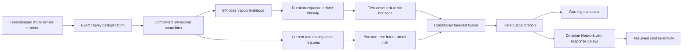

# Paper specification supported by the current experiments

**Newest completed round:** [selective fusion results](../experiments/selective_fusion/REPORT.md)
add fitting-campaign pooled calibration and weights by horizon/availability.
A prespecified .25 state blend improves 30-minute coverage and Brier against
original counts, with a campaign-dependent false-episode reduction. Without
Wazuh, the adaptive blend improves coverage/Brier/AP against matched pooled
counts while increasing negative warning duration. The full-input adaptive
15-minute target fails. Preserve all six variants and these limited scopes;
the positive control must not be relabeled as a test-selected primary success.

**Completed revision:** [availability/state-feature results](../experiments/robust_forecasting/REPORT.md)
test a second substantive BN/HMM/Decision Network integration. Sensor-aware
counts routing recovers some outage warnings, but full-input state features
worsen 15-minute coverage and Brier. A probability-preserving confirmation
revision selects zero HMM confirmation at both primary horizons. Keep these
negative results and distinguish counts-routing gains from state-model gains.
No overall improvement or complete published-system superiority is established.

Working title: **Forecasting Cyberattack Onset from Multi-Sensor Alerts:
Duration Models, Learned Fusion and Warning–Calibration Tradeoffs**.

The study is implemented and its exploratory results are available in
[the extended report](../experiments/extended_study/REPORT.md). It establishes
specific differences against standard component baselines. It does not prove
the complete pipeline is original, better than all published systems, or ready
for publication without further validation. Preserve that distinction in the
abstract, introduction and conclusion.

The [publication validation report](../experiments/publication_validation/REPORT.md)
and [manuscript draft](PAPER_DRAFT.md) now add successful victim-side outcomes,
strict new-alarm scoring, HMM/GRU method adaptations and a negative external
transfer diagnostic. These supplement the exploratory evidence, and narrow
the main claim to endpoint-audited, horizon-dependent empirical tradeoffs.

## Research question and implemented pipeline

Does combining a duration-aware generative forecast with a direct supervised
forecast improve prospective warning coverage or false-warning burden, and
what probability-quality and sensor-failure tradeoffs accompany that change?

All observations are past-only at the evaluated bin boundary. Ground-truth
stage labels train models and define targets; they never generate input
features. Predictor timestamps use alert/log timestamps; actual receipt-time
availability is an unresolved deployment assumption. Counts contain detector
IDs, not endpoint labels or attacker/host identities. DARPA packet features use
anonymous protocol, port and cardinality indicators. Its known victim address
is used only in a separate ground-truth flood rule.

| Syllabus requirement | Implemented component |
|---|---|
| Unit 1: Bayesian Networks/inference | Threat-state parent with categorical detector-count children; compute one factorized observation likelihood. Conditional logistic CPD combines correlated forecast sources. |
| Unit 2: Hidden Markov Models | Forward filtering on a minute clock, stage-age state expansion and first-onset projection. Standard geometric-duration HMM is an ablation. |
| Unit 3: Decision Networks | Onset-time chance node, action decision, assumed action effect and damage/disruption utility; compare delay-aware and delay-ignoring choices. |

The observation model assumes count variables are conditionally independent
given the stage. This simplifying assumption is not guaranteed by exact replay
deduplication. The BN-HMM is mathematically a factorized-emission HMM, not two
independent posterior distributions to multiply. Stage ages implement standard
explicit-duration semi-Markov modeling through an expanded HMM. Learned fusion
is standard stacking; its CPD interpretation is not a claim of physical
causality or a new Bayesian algorithm.

## Mathematical definition

For threat state S and observed count buckets x at t:

`L_t(s) = product_j P(x_tj | S_t = s)`

`b_t(s) ∝ L_t(s) sum_r A_rs b_(t-1)(r)`

For the duration model, replace s with (stage, age) and learn intermediate
stage exit hazards from fitting-run durations. Benign waiting remains
geometric. The target state is absorbing. The future first-onset probability
uses only posterior mass that has not already entered the target:

`p_h(t) = b_t^T [u - A^h u]`, with `u = 1` on non-target states and `0` on target.

The direct tree predicts `P(t < T ≤ t+h | current and trailing counts)`.
For each horizon h, the fusion CPD is

`q_h = sigmoid(beta_0h + beta_1h logit(p_duration,h) + beta_2h logit(p_tree,h))`.

Fit coefficients on inner out-of-scenario predictions, never in-sample base
predictions or outer test targets. Apply a separate validation logistic
calibrator with nonnegative slope and enforce cumulative horizon monotonicity.
The raw forecasts are also released. Independent horizon models are not a
full jointly learned onset-time distribution; monotonicity provides usable
coarse chance bins for the response model.

For action a with disruption c_a, delay d_a, assumed efficacy e_a and damage D:

`ExpectedLoss(a) = c_a + D [q_30 - e_a max(0, q_30 - q_d_a)]`.

Monitor has zero efficacy and disruption. Delay-aware choice minimizes this
loss. The comparison policy assumes no delay when selecting, but both cost
evaluations respect declared delay. Passive-log costs are framewise proxies,
not observed attack prevention or a sequential policy simulation.

## What can be claimed from this study

The fixed feature ablations provide the clearest 15-minute improvement from
combining inputs: the three-sensor temporal tree warns on 5/8 campaigns versus
2/8 for the AMiner-only tree, with three false-warning episodes for each.
Mean Brier decreases from 0.001576 to 0.001098 (30.3%) and AP increases from
0.6565 to 0.7214. Wazuh-only warns on 2/8 and Suricata-only on 0/8. Removing
temporal means from the full tree yields 0/8 warnings. This is evidence for
multi-sensor temporal features in this task, not a novel ensemble principle.
At five minutes AMiner-only has 3/8 warnings and AP 0.511, better than the
full tree and fusion on those metrics; preserve that contrary finding.

The report contains every horizon and campaign, raw/calibrated predictions,
fixed operating points, natural-trace and sensor-removal results, and 27
response-cost/effect settings. Use the actual values from those artifacts.

An accurate preliminary result statement is:

> On eight reused AIT scenarios, learned forecast fusion reduced 30-minute
> false-warning episodes from 20 to 5 at the same 5/8 episode warning coverage
> as the boosted-tree forecaster, with worse Brier error and average precision.
> Most of the alarm reduction arose in one scenario. With Suricata removed,
> 15-minute warning coverage was 5/8 versus 3/8, while other sensor removals
> defeated both forecasters. These findings identify operating tradeoffs rather
> than establish universal superiority.

At five minutes, fusion's mean Brier and AP improve slightly, but each method
warns on only one campaign, and it is a different campaign for each method.
The Brier and false-warning descriptive bootstrap intervals include zero.
At 15 minutes boosting has better Brier/AP than fusion. Equal averaging loses
probability quality and at 15 minutes also loses warning coverage.

DARPA is a separate transfer case study: duration modeling improves mean
15-minute Brier by approximately 9.8% over the ordinary detector HMM, but warns
on only one of two campaigns and raises six false-warning episodes. Do not
pool DARPA and AIT as one attack task. AIT forecasts scheduled privilege
escalation; DARPA forecasts observed ACK flood emission. Earlier malicious
stages can already have occurred in both tasks. MIT documents that the DARPA
flood did not successfully cause denial of service.

No result establishes that response-delay modeling reliably lowers cost.
The fusion policy's assumed AIT cost improves in 11/27 settings and worsens in
16/27. Do not use a favorable cost setting alone as proof of prevention.

## Related work and originality

Existing [HMM attack prediction](https://arxiv.org/abs/2106.02012),
[real-time multistep HMM prediction](https://portalcientifico.upm.es/en/ipublic/item/5643464),
[HSMM intrusion anomaly detection](https://www.sciencedirect.com/science/article/pii/S0096300308003342)
and [cross-validated stacking](https://scikit-learn.org/stable/modules/generated/sklearn.ensemble.StackingClassifier.html)
preclude first-ever claims for those individual principles. The fuller
[literature audit](NOVELTY_AUDIT.md) covers Bayesian alert fusion and
forecast-based response precedents. Accessible primary descriptions were
checked; unavailable full systems remain unresolved comparisons.

The present contribution candidate is an empirical comparison and reproducible
protocol for prospective warning–calibration tradeoffs. Exact pipeline naming
and syllabus coverage do not establish originality. Named paper systems must
be faithfully reproduced or clearly adapted before reporting that we beat
them. Standard components in this study are not faithful full-system
reproductions, and classification accuracy/F1 from other tasks is incompatible.

## Paper structure and evidence needed before submission

1. Define the future endpoint and how pre-onset warnings differ from current
   stage detection. State reused development data and receipt-time assumptions.
2. Describe the conventional model components, inner/outer splits and fixed
   settings, with the pipeline and equations above.
3. Present every natural-trace comparator and feature/model ablation, including
   the stronger tree baseline, raw/calibrated metrics and negative results.
4. Present all sensor removals and response sensitivity; preserve campaign
   identities and exposure instead of treating alerts as independent samples.
5. Discuss phase semantics, scheduled versus successful outcomes, tiny attack
   counts, conditional observation independence and concentration of gains.
6. Freeze the candidate and evaluate new independent runs, including benign-only
   and aborted attacks. Verify execution and actual availability times from
   raw logs. Reproduce the closest published forecasters on that same endpoint.
7. Release scripts, provenance, annotation rules, split manifests, predictions,
   software versions, checks and figures; separate preliminary claims from
   fresh confirmatory results.

These are concrete remaining research requirements, not work that can be
replaced by more random alert splits or tuning the eight current scenarios.
For an empirical/benchmark venue, a carefully scoped tradeoff study may be
viable; acceptance and an original algorithm are not established here.

## Reproduction

From the project root, run `backend/research/run_extended_study.ps1` with
Python 3.14.2 and the pinned scientific packages in
`backend/research/requirements-research.txt`. The public AIT archive and labels
are already downloaded and checksummed; DARPA archives remain in place. The
research preparation reads members as streams without extracting arbitrary
archive paths. Application tests additionally require the existing backend
dependencies. Generated reports and standalone PNG/PDF figures are under
`experiments/extended_study/`.
