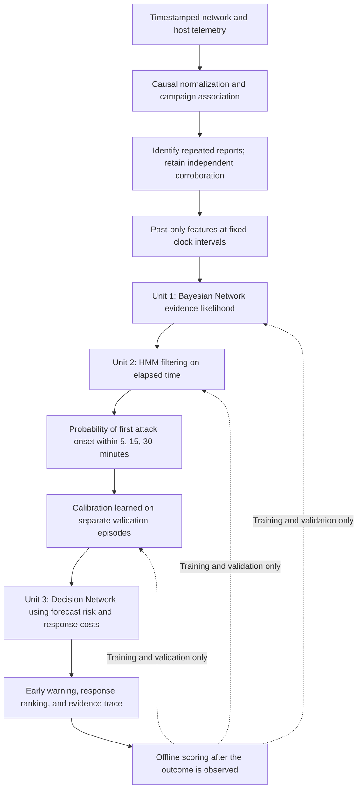

**Research pipeline proposal: Early Attack Forecasting with Evidence-Aware Bayesian Temporal Inference and Utility-Based Response**

Prepared on 4 October 2026. This is a design and experiment specification. The proposed modules are not implemented, the improvements are hypotheses, and novelty has not been established by an exhaustive literature review.

Literature audit update: [NOVELTY_AUDIT.md](NOVELTY_AUDIT.md) documents substantial precedents for the components and several functional combinations. The exact complete implementation was not verified in another source, but originality remains unestablished. The candidate contribution below is a hypothesis requiring a distinct method or convincing comparative results; it is not an approved first-ever claim.

The objective is to forecast a harmful attack outcome before its onset using evidence available at the prediction time. The initial outcome is DDoS launch. Reconnaissance, discovery, and compromise can already be malicious; forecasting DDoS from these precursors is the claim. Predicting the first malicious action from benign-only activity would require a separate task, suitable precursor data, and separate experiments.

**The question the system answers**

For a specified network or campaign context at time t, estimate the probability that its first DDoS launch will occur within the next 5, 15, or 30 minutes, and recommend a response whose expected benefit exceeds its operational cost. These horizons are starting design choices; finalize them from training/validation data and operational needs before opening the test set.

Example output, with illustrative values rather than experimental results: "DDoS onset risk within 15 minutes: 0.72; dominant current state: compromise; recommended action: block; independent supporting evidence: discovery followed by exploitation; repeated reports: collapsed." A probability is a forecast, not a promise that an attack will occur.

**The proposed pipeline**

| Syllabus unit | Required topic | Substantive role |
|---|---|---|
| Unit 1 | Bayesian Networks and inference | Learn conditional evidence distributions and infer threat-state likelihoods from observable features. |
| Unit 2 | Hidden Markov Models | Filter latent attack stages and project probabilities through a model with a defined clock interval. |
| Unit 3 | Decision Networks | Select a response using forecast outcome probabilities, action feasibility, costs, and explicitly modeled consequences. |

**Stage 1: Construct a causal evidence stream**

Store event time, ingestion time, sensor ID, source event ID, observable event attributes, and links to original records. Keep ground-truth stages and attack-onset annotations in a separate evaluation channel. A predictor must not receive filenames containing phase numbers, true phase labels, future timestamps, or label-derived signatures.

Forecast for a network/campaign context with a grouping rule that uses only current and past observations. Do not group test events using the known attacker list or completed attack graph. Do not reset the model at boundaries discovered from future attack labels. Keep parallel contexts separate so unrelated attacks cannot advance one another's state.

Collapse exact replays of the same sensor event. Match possible cross-sensor reports conservatively using session identifiers, observable attributes, timestamps, and sensor identity. Maintain an evidence ledger so repeated copies and distinct observations are distinguishable. Independent corroboration remains informative, and distinct packets/requests still contribute to genuine traffic-rate features.

Matching mistakes must be evaluated: two genuinely different events can look similar, and two reports of the same event can differ. Start with verified exact duplicates and known event identities; introduce uncertain cross-sensor matching only after the basic model is evaluated.

Aggregate features on a fixed calendar grid, initially 30 seconds. Keep windows ending at t, never centered on t. Features can include unique targets, service diversity, unique-event rate, signature counts, host changes, sensor availability, and agreement. Sensor silence and missing telemetry are different: if collection health is unknown, mark that interval unobserved instead of claiming that no activity occurred. A dataset containing only phase-specific attack alerts cannot establish benign network silence.

**Stage 2: Use the BN as the HMM observation model**

The current implementation independently feeds signatures into the BN and HMM, then combines their posteriors with a fixed 75/25 weighted product. The proposed design uses the BN evidence likelihood once in temporal filtering.

Let S_t be the latent stage, E_t the past-only evidence for the current interval, and L_t(s) = P(E_t | S_t = s). Learn BN conditional probability tables from training campaigns, with smoothing. Represent important evidence dependencies when supported by data; ports and signatures derived from the same event should not automatically be treated as conditionally independent.

Use actual BN inference for the stated graph. If only a static BN posterior q_t(s) is exposed, and its training prior rho(s) is positive, recover a proportional likelihood as L_t(s) proportional to q_t(s) / rho(s). Multiplying q_t directly by a temporal prior would count the static prior again. Weighted heuristic scores are not automatically an exact BN posterior and need a separate baseline label.

The coherent BN-to-HMM interface is established probabilistic modeling, so it is not by itself the novelty claim. Its value here is to make the information flow explicit and measurable.

**Stage 3: Track attack progression on the clock**

Use six initial states: Benign, Reconnaissance, Discovery, Compromise, Persistence/Preparation, and DDoS Active. The existing PrivEsc label represents mstream installation; use a name that matches the annotation rather than asserting that every installation event proves privilege escalation.

Learn the transition matrix A for the fixed time interval from training episodes, with regularization and transparent domain constraints. Include plausible stalled and aborted campaigns, and return-to-benign behavior. A model in which every scan inevitably becomes an attack will produce misleading forecasts. Do not force ActiveAttack probability to one merely because it previously exceeded 0.5.

For a fully observed interval:

    predicted_belief_t = belief_(t-1) A
    belief_t(s) = normalize(predicted_belief_t(s) L_t(s))

For an unobserved interval, propagate the prior with A and omit the measurement update. Over k unobserved grid intervals use A^k. Use one joint BN likelihood for the interval, not an additional signature emission after that likelihood. Reprocessing the same recorded evidence at the same time must not advance the model.

A continuous-time HMM is a possible later extension, not a prerequisite for the first paper. Time-based probabilistic attack-state estimation already exists in [Lefebvre et al., 2022](https://iris.unica.it/handle/11584/345189), so accounting for timestamps alone is not a novelty claim.

**Stage 4: Forecast attack onset, not just the next stage**

Define T_attack from an independently documented DDoS-launch annotation. During evaluation, forecast only at t < T_attack for positive episodes. Ongoing-attack detection is a separate output and separate score.

The target is F_t(h) = P(t < T_attack <= t+h | evidence available at t, target outcome has not yet occurred). The model should also expose its probability that the outcome is already ongoing; analysts must be able to distinguish these two quantities.

With an absorbing DDoS target for the forecasting calculation, let Q be A restricted to non-target states, and let b_minus be the current belief normalized over those states. For a horizon of k grid intervals:

    F_t(k intervals) = 1 - b_minus Q^k 1

This estimates first arrival at the target, conditional on still being in a non-target state. It is more directly matched to onset forecasting than asking for the most likely state at the next alert. Compute onset-time bins from successive cumulative probabilities. Calibrate the bins jointly or use a monotone calibration method so risk within 5 minutes <= risk within 15 minutes <= risk within 30 minutes.

First-arrival probabilities and horizon calibration are established techniques. The prospective contribution is their integration with controlled evidence reuse and pre-onset response selection under telemetry perturbations.

**Stage 5: Select a response using future risk**

Build a Decision Network with chance variables for onset-time bin and relevant current context, a decision node for Monitor/Restrict/Block/Isolate, chance variables for response completion and effectiveness, and a utility node for disruption plus attack loss. Its information arcs must identify what is observable when the action is selected.

Use disjoint onset bins (0-5, 5-15, 15-30 minutes, or beyond the planning horizon) as one distribution. Do not add independent expected losses for all three cumulative horizons, because those events overlap.

For a selected planning horizon, evaluate:

    action_star = argmax_action sum_outcome P(outcome | evidence, action, assumptions) U(outcome, action)

Action completion time matters: a recommended block that completes after the predicted onset cannot be credited with preventing that onset. Include feasible actions and cost sensitivity. Start with clearly stated expert/simulation assumptions for mitigation effects. Historical passive attack logs cannot establish how an unexecuted action would have changed the outcome; empirically validate prevention effects only with independently designed defensive replay or cyber-range experiments.

Use separate validation episodes to set warning thresholds, smoothing, and cooldowns. A warning should be issued because future risk warrants it. Do not require future attack labels or retrospective confirmation. Recommendations remain decision support in the first implementation.

**Stage 6: Present forecasts and preserve their evidence**

The dashboard should show a forecast timestamp, target outcome, horizon probabilities, suspected ongoing-attack probability, warning status, ranked actions, relevant costs, sensor availability, and links to unique supporting events. Add an onset marker after the outcome is known and show how much useful warning time the forecast provided. Clearly label simulated action effects.

The trace records evidence identities, any merged reports, model/calibration versions, previous and updated belief, forecast values, action scores, and timing assumptions. Audit numerical replay and evidence-to-action sensitivity. Checking that JSON fields exist is trace completeness, not proof that an explanation is faithful.

**The candidate novelty and how to test it**

Proposed contribution statement: "We develop an evidence-aware Bayesian temporal forecasting and response architecture that controls duplicated and shared evidence, predicts attack onset over clock-based horizons, and evaluates defensive decisions before onset under unreliable telemetry."

The central hypothesis is that controlling evidence reuse while aligning temporal filtering and response selection with future onset improves the warning-time/false-warning trade-off and response utility compared with conventional posterior fusion and present-state decisions.

| Mechanism | Hypothesized benefit | Evidence needed |
|---|---|---|
| Exact-report replay invariance across normalization, filtering, and forecasting | Replayed copies cannot increase confidence or advance attack time. | Compare beliefs, forecasts, and actions before/after repeated identical reports, at the same evaluation timestamps. |
| Joint BN likelihood used once by the HMM | Less overconfidence from shared signature evidence. | Calibration and pre-onset warning comparison against the existing fixed product and a tuned fusion baseline. |
| Clock-based first-onset forecasts | Predictions remain meaningful across varying report counts and missing intervals. | Time-horizon accuracy and lead time under realistic timing perturbations and sensor outages. |
| Forecast-based Decision Network | More useful early action choices at comparable disruption cost. | Comparison with the same Decision Network using present-state probabilities, under declared action-effect assumptions. |

Exact replay invariance is a design property, not automatically a scientific innovation. Ordinary deduplication must be a baseline. Cross-sensor corroboration should affect beliefs when it is new evidence. Higher robustness is an experimental hypothesis, not a promised outcome.

Relevant overlap already exists: [Devarakonda et al., 2012](https://www.sciencedirect.com/science/article/pii/S221201731200360X) combine BN and HMM for intrusion detection; [Attack plan recognition using hidden Markov and probabilistic inference, 2020](https://www.sciencedirect.com/science/article/abs/pii/S0167404820302479) combines temporal and Bayesian reasoning; [Wang and Neil, 2021](https://arxiv.org/abs/2106.00471) study Bayesian defense decisions. The precise difference must be established against these works before claiming an original integration.

Alert aggregation also has established methods, including [Landauer et al., 2022](https://doi.org/10.1145/3510581). A 2026 preprint, [PARD-SSM](https://arxiv.org/abs/2604.02299), reports pre-onset predictive warnings. The published [Simulation-Informed Bayesian Stackelberg Defense for Multi-Stage Cyber Attacks, 2026](https://doi.org/10.3390/computers15080545) connects simulated attack-action likelihoods and sequential Bayesian updates to defensive decisions; calibration of first-onset forecasts was not established. [ProSpaCT, September 2026 preprint](https://papers.ssrn.com/sol3/papers.cfm?abstract_id=7435044) explicitly connects calibrated cyber-risk forecasting with operational intervention costs according to its abstract. Early warning, aggregation, or forecasts connected to decisions cannot independently serve as first-ever claims. See the audit for confirmed overlaps, source access limits, and outstanding method comparisons.

**Data required for a credible paper**

The current database contains 7,029 LLDOS 1.0 alert rows and 32 LLDOS 2.0.2 rows. Its real-scenario tables contain stages 1-5 and no stage-0 benign rows. Counts were inspected read-only. Those are many reports from only two scenario datasets, not thousands of independent attack episodes. [MIT Lincoln Laboratory](https://www.ll.mit.edu/r-d/datasets/2000-darpa-intrusion-detection-scenario-specific-datasets) documents the two DDoS scenarios and their five phases.

Use these scenarios for pipeline debugging and illustrative replay. Recover original background telemetry and verify independent onset annotations before treating gaps as no activity. For generalizable DDoS results, add multiple independently executed DDoS campaigns with precursors, benign-only episodes, and failed/aborted campaigns. A cyber range can provide known underlying event identities, randomized stage timing, and controlled sensor degradation. The test generator must not simply reproduce the fitted HMM or the existing synthetic generator's same transition assumptions.

For an additional multi-stage evaluation, the [AIT alert dataset paper](https://arxiv.org/abs/2308.12627) describes three IDSs monitoring eight attack executions with normal activity; the underlying [AIT Log Data Set V2.0](https://zenodo.org/records/5789064) provides heterogeneous logs and attack-step labels. Check target-outcome coverage, endpoint labels, temporal ordering, storage needs, and license before adopting it. Its terminal outcome would need its own documented definition and refitted model; do not relabel exfiltration or another outcome as DDoS. It is a possible complementary benchmark, not a verified DDoS replacement.

Separate train, calibration/validation, and test sets by independent campaign/run, with chronology preserved. Keep correlated sensors and replay variants of the same run in the same split. If temporal splits within long traces are unavoidable, purge overlapping feature/look-ahead windows and exclude boundaries without sufficient follow-up. Do not randomly split neighboring alert rows.

For each horizon h, assign y(t,h)=1 if independently annotated onset is in (t,t+h], and 0 if the full interval is observed without onset. A trace ending before t+h is censored: exclude that example from the binary-horizon score or use a prespecified survival method. Avoid post-onset features and training-derived label shortcuts. Fit preprocessing, evidence grouping parameters, transitions, calibration, and thresholds without test labels.

**Experiments and baselines**

1. Establish clean precursor-only forecasting with persistence, stage-threshold rules, and a direct supervised future-onset classifier such as logistic regression or a tree ensemble. All receive the same past-only information and forecast labels; persistence must use estimated rather than ground-truth current state.
2. Compare standalone BN forecasting, standalone HMM, coherent BN-HMM forecasting, the current fixed posterior mixture, and a validation-tuned fusion baseline. A BN current-stage classifier needs a separately fitted future-onset mapping to qualify as a forecasting baseline.
3. Compare present-state response rules with forecast-based response selection using identical costs, feasibility constraints, and action-effect assumptions. Include a simple forecast-threshold policy to isolate the Decision Network's benefit.
4. Run controlled ablations: ordinary deduplication alone; clock alignment alone; coherent likelihood interface alone; forecast-based decision alone; full integration. Match model capacity and tuning budgets where possible. Inspect performance without dataset-specific IP/phase boosts.
5. Stress-test exact duplicates, realistic cross-sensor overlap, uncertain event matching, dropped intervals, entire-sensor outages, sensor conflicts, and changed campaign timing. Replay transformations preserve underlying attack onset and unique-event ground truth. Compare at identical clock timestamps, not a greater number of duplicated rows.
6. Evaluate on held-out campaigns and, where endpoint semantics permit, a second dataset. Report paired campaign-level uncertainty. More random seeds or repeated perturbations of one campaign do not create independent real attacks.

Primary metrics are pre-onset episode recall at a fixed false-warning budget; median warning lead time; and false-warning episodes per benign hour. Lead time is onset minus the first qualifying warning inside the selected horizon. Give missed attacks explicitly; do not report lead time only for successes without their coverage. Merge repeated warnings using a prespecified policy, and count warnings outside the forecast horizon as false forecasts for that horizon.

Secondary metrics are horizon PR-AUC, precision, recall, Brier score, calibration curves, response utility under declared assumptions, unnecessary Block/Isolate decisions, decision stability under replay, latency, and memory. Current-stage macro-F1 is useful but does not establish future-onset prediction. Evaluate all metrics on common clock grids; do not let high report volume dominate episode-level conclusions. Bootstrap by campaign/run rather than individual alert.

**Implementation sequence in this repository**

| Step | Existing code | Deliverable |
|---|---|---|
| 1 | ingestion/normalizer.py, xml_parser.py, database.py | Label-independent evidence; separate truth; event/ingestion timestamps; unique report identities; episode metadata. |
| 2 | models/bayesian_network.py | Actual BN likelihood API, train-only CPDs, explicit evidence-dependency assumptions. |
| 3 | models/hmm_model.py, pipeline.py | Per-context state, fixed clock progression, missing-interval handling, learned transitions, single evidence update. |
| 4 | New onset_forecaster.py and forecast_calibration.py | First-onset probabilities, coherent horizons, separate calibration artifact. |
| 5 | models/decision_network.py | Forecast-outcome chance nodes, action timing, explicit outcome/cost assumptions, utility ranking. |
| 6 | evaluation/experiment_runner.py | Campaign splits, onset labels, censoring, pre-onset metrics, corrected baselines and ablations. |
| 7 | API and frontend components | Horizon forecast panel, pre-onset warning timeline, evidence replay, response justification. |

Recommended first milestone: implement clean forecasting and its baselines before the full response extension. Advance the proposed integration only if held-out evaluation shows a useful improvement or a reproducible trade-off worth reporting. Preserve negative results and report which component helps under which conditions.

**Paper framing and completion criteria**

Working title: "Evidence-Aware Bayesian Temporal Forecasting and Decision Support for Early Cyberattack Warning."

The paper should define the pre-onset task, compare the closest architecture details, derive the inference/forecast/decision interfaces, document the datasets and campaign split, and present ablations, calibration, useful warning time, and limitations. Release executable configurations, dataset preparation code, split manifests, model versions, and result-generation scripts, subject to dataset licenses.

Before submission, establish a precise contribution beyond generic BN+HMM integration; demonstrate reliable held-out improvement over strong simple and relevant published baselines; include sufficient independent episodes and benign exposure; and explain whether response gains are empirical or conditional on simulation assumptions. Publication is a goal, not a guaranteed result. Describe originality as a proposed contribution until the focused full-text literature comparison is complete, and describe performance gains only after the experiments produce them.
