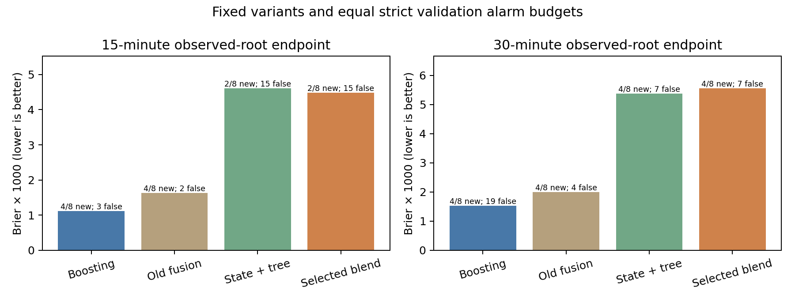

# Revised BN/HMM forecasting: completed improvement analysis

A later development round is complete: [selective fusion and pooled campaign calibration](../selective_fusion/REPORT.md). It finds a conditional positive 30-minute result for a prespecified .25 state blend and an outage-specific selective-fusion gain, while its adaptive 15-minute primary target fails. The fixed first-revision results below are retained.

**Verdict: explicit sensor availability improves some outage warnings, but the revised BN/HMM combination does not surpass the original boosting model overall. Full-input 15-minute warning coverage falls from 4/8 to 2/8, false episodes rise from 3 to 15, and mean Brier error is about four times larger. The probability-preserving alarm revision selects no HMM confirmation at 15/30 minutes, so it retains the baseline results without an additional HMM gain.**

This report retains every fixed revised variant and every negative result. All AIT campaigns and the three existing CAM diagnostic targets had already been inspected; this is exploratory. New code does not establish independent confirmation, unique architecture, publication acceptance or superiority over complete published systems.

## What changed

The original pipeline fused a duration-HMM onset forecast and boosting probabilities. The revised pipeline uses a BN stage-parent/count-child observation likelihood to infer a causal HMM state posterior, then supplies that posterior and its trailing summaries to boosting alongside the original count history. State features for each fitting campaign come from HMMs fitted to the other five fitting campaigns; validation/test filtering uses the six fitting campaigns. No test stage labels or attack outcome enter prediction.

Available detector families are explicit inputs. Experts are fitted for all seven nonempty sensor subsets, omitting unavailable sensors from both the BN likelihood and tree inputs. Missing sensors are not filled with fake alerts or interpreted as observed zero counts. With no sensors the API abstains. The current experiment supplies known static availability; measured heartbeats and dynamic outage handling are not established.

Three fixed variants are reported: counts-only availability experts; counts plus inferred BN/HMM state features; and a validation-selected mixture of those two. The mixture selects one coefficient across all horizons from {0,.25,.5,.75,1}, minimizing normalized validation Brier plus a .01 weight penalty. Calibration and selection reuse the same validation campaign. The fallback can omit state information from the risk forecast; it cannot guarantee test improvement.

Unit 3 remains the Decision Network using the forecast onset distribution, response delay, assumed effect and damage/disruption utility. The same original 27 cost/effect settings were rescored. No defensive action was physically executed.

The first protocol fixed the three forecast variants before their complete results. Longer-history/clock controls were specified as supplementary diagnostics. After observing the revised probability losses, a second recorded protocol separated the counts-only probability forecast from optional BN/HMM alarm confirmation. This second round is explicitly adaptive exploration; it is not an untouched confirmation experiment. All failed first-round variants remain in the report.

## Full-input comparisons before verified successful root outcomes

All rows below use the same strict validation-selected alarm policy: budget 1 false episode per 24 negative hours and at most five negative warning minutes. Timely warning episodes must BEGIN inside the forecast window. Original fusion is rescored under this rule, so its totals can differ from its older permissive-threshold report. Model fitting still targets scheduled escalation; root scoring is an endpoint sensitivity rescore. Lower Brier is better; higher AP is better.

### 15-minute forecasts

| Model | Mean Brier | Mean AP | Timely new warnings / 8 | False episodes | Median timely lead (min) |
|---|---:|---:|---:|---:|---:|
| Original boosting | 0.0011185 | 0.7177 | 4 | 3 | 11.19 |
| Original duration/tree fusion | 0.0016302 | 0.6830 | 4 | 2 | 10.57 |
| Longer validation-selected GRU | 0.0044173 | 0.4301 | 1 | 8 | 3.66 |
| BN/HMM-state + boosting | 0.0046083 | 0.6559 | 2 | 15 | 12.87 |
| Validation-selected state blend | 0.0044877 | 0.6468 | 2 | 15 | 12.87 |

BN/HMM-state + boosting: Brier improvement versus boosting -312.0%, versus original fusion -182.7%; timely coverage 2/8 and 15 false episodes. A negative percentage means deterioration.

Validation-selected state blend: Brier improvement versus boosting -301.2%, versus original fusion -175.3%; timely coverage 2/8 and 15 false episodes. A negative percentage means deterioration.

### 30-minute forecasts

| Model | Mean Brier | Mean AP | Timely new warnings / 8 | False episodes | Median timely lead (min) |
|---|---:|---:|---:|---:|---:|
| Original boosting | 0.0015254 | 0.8320 | 4 | 19 | 20.90 |
| Original duration/tree fusion | 0.0019966 | 0.7705 | 4 | 4 | 19.87 |
| Longer validation-selected GRU | 0.0068378 | 0.3607 | 4 | 16 | 19.60 |
| BN/HMM-state + boosting | 0.0053693 | 0.7733 | 4 | 7 | 25.57 |
| Validation-selected state blend | 0.0055548 | 0.7735 | 4 | 7 | 25.57 |

BN/HMM-state + boosting: Brier improvement versus boosting -252.0%, versus original fusion -168.9%; timely coverage 4/8 and 7 false episodes. A negative percentage means deterioration.

Validation-selected state blend: Brier improvement versus boosting -264.2%, versus original fusion -178.2%; timely coverage 4/8 and 7 false episodes. A negative percentage means deterioration.

### Five-minute forecast: a limited positive result

| Model | Mean Brier | Mean AP | Timely new warnings / 8 | False episodes | Median timely lead (min) |
|---|---:|---:|---:|---:|---:|
| Availability-specific boosting | 0.0008456 | 0.3109 | 0 | 6 | — |
| BN/HMM-state + boosting | 0.0036992 | 0.4139 | 1 | 2 | 4.72 |
| Validation-selected state blend | 0.0036681 | 0.4701 | 1 | 2 | 4.72 |

The state variants produce one timely new warning versus zero for counts-only, and higher mean AP, but substantially worse Brier. One recovered case is a conditional warning/ranking gain, not an across-metric improvement.

## Longer-history and elapsed-clock controls

The elapsed-clock control uses only minutes since the first recorded bin. The longer-history control augments the original counts with trailing 180-, 360- and 1440-minute means and elapsed clock. It uses the same fitting campaigns, model settings, validation calibration and alarm rule. These controls test whether added temporal context alone can explain improvements; elapsed recording time may itself be dataset-specific. Neither control was eligible for the earlier blend selection.

### 15-minute control comparison

| Model | Mean Brier | Mean AP | Timely new warnings / 8 | False episodes | Median timely lead (min) |
|---|---:|---:|---:|---:|---:|
| Availability-specific boosting | 0.0011185 | 0.7177 | 4 | 3 | 11.19 |
| Elapsed-clock-only boosting | 0.0026397 | 0.0438 | 0 | 0 | — |
| Counts + longer history + elapsed clock | 0.0020561 | 0.6532 | 2 | 2 | 4.29 |
| BN/HMM-state + boosting | 0.0046083 | 0.6559 | 2 | 15 | 12.87 |

### 30-minute control comparison

| Model | Mean Brier | Mean AP | Timely new warnings / 8 | False episodes | Median timely lead (min) |
|---|---:|---:|---:|---:|---:|
| Availability-specific boosting | 0.0015254 | 0.8320 | 4 | 19 | 20.90 |
| Elapsed-clock-only boosting | 0.0052618 | 0.0855 | 0 | 0 | — |
| Counts + longer history + elapsed clock | 0.0024595 | 0.8470 | 0 | 4 | — |
| BN/HMM-state + boosting | 0.0053693 | 0.7733 | 4 | 7 | 25.57 |

Longer history improves 30-minute mean AP relative to the original count model, but produces no timely new warnings at this policy and has higher Brier. Elapsed-clock-only forecasts perform poorly. These results do not establish that BN/HMM state features are the best way to add temporal information.

## Probability-preserving alarm revision

The second revision preserves availability-specific boosting probabilities exactly. A separate alarm branch may require posterior mass in the last two HMM stages to exceed 0, .5 or .9. Probability error and ranking are evaluated on the unchanged probabilities, not on the masked alarm score. Validation chooses the confirmation level and risk threshold under the same strict alarm budget; level 0 disables confirmation and wins ties. The BN and HMM therefore have a tested candidate role, not an assumed improvement.

| Horizon | Nonzero confirmations selected / 8 | Timely new warnings / 8 | False episodes | Suppressed warning minutes |
|---|---:|---:|---:|---:|
| 15 min | 0 | 4 | 3 | 0 |
| 30 min | 0 | 4 | 19 | 0 |

At both main horizons, every tested availability subset and all four validation budgets select level 0. Therefore this revision preserves the baseline, including its failures; it supplies no demonstrated additional BN/HMM warning contribution. A module being computed does not establish a useful contribution from that module. Complete choices, including other horizons, are retained in `gate_selection.json`; `gate_summary.csv` includes all endpoint/subset/policy results.

## Syllabus participation and what was selected

| Unit | Actual implemented role |
|---|---|
| 1 | Fitting-only BN count conditional tables and observation likelihood, omitting missing children; fixed tempered evidence |
| 2 | Forward HMM state belief and causal trailing state summaries supplied to the augmented tree |
| 3 | Onset-distribution chance node, delayed-response decision and expected loss |

| Test campaign | Selected state-augmented weight | State-feature splits at 15 / 30 min |
|---|---:|---:|
| fox | 1 | 406 / 364 |
| harrison | 1 | 381 / 427 |
| russellmitchell | 1 | 368 / 376 |
| santos | 1 | 462 / 491 |
| shaw | 1 | 413 / 434 |
| wardbeck | 0 | 368 / 324 |
| wheeler | 1 | 344 / 249 |
| wilson | 1 | 335 / 383 |

The split audit establishes actual use of state features in the augmented model. A selected mixture weight of zero means the risk branch falls back to counts-only; that case does not demonstrate additional HMM predictive value, even though state diagnostics are computed. All augmented-model results are retained separately.

## Alarm-policy sensitivity

| Horizon | Validation budget / 24h | Original boosting new / false | Original fusion new / false | State-augmented new / false | Selected blend new / false |
|---|---:|---:|---:|---:|---:|
| 15 min | 0 | 3 / 2 | 2 / 1 | 2 / 12 | 2 / 12 |
| 15 min | 0.25 | 4 / 2 | 4 / 1 | 2 / 12 | 2 / 12 |
| 15 min | 1 | 4 / 3 | 4 / 2 | 2 / 15 | 2 / 15 |
| 15 min | 4 | 4 / 3 | 4 / 2 | 2 / 15 | 2 / 15 |
| 30 min | 0 | 4 / 2 | 3 / 2 | 4 / 7 | 4 / 7 |
| 30 min | 0.25 | 4 / 2 | 3 / 2 | 4 / 7 | 4 / 7 |
| 30 min | 1 | 4 / 19 | 4 / 4 | 4 / 7 | 4 / 7 |
| 30 min | 4 | 4 / 19 | 4 / 4 | 4 / 7 | 4 / 7 |

## Campaign dependence

| Model, 30 min at budget 1 | Timely new warnings excluding wheeler / 7 | False episodes excluding wheeler |
|---|---:|---:|
| Availability-specific boosting | 4 | 2 |
| BN/HMM-state + boosting | 4 | 7 |
| Validation-selected state blend | 4 | 7 |

Paired per-campaign differences and descriptive bootstrap intervals are in `paired_comparisons.json`. Eight related campaigns, overlapping fits and repeated exploratory comparisons do not justify confirmatory significance or independence claims.

## Complete sensor removal

The following comparison uses scheduled escalation at 15 minutes, so it can be compared with the original outage experiment. Old thresholds were unchanged natural-validation thresholds and permissive warning coverage; new thresholds use matching-availability validation and strict starts. This evaluates a complete revised availability/selection policy, not just a single inference change. The new counts-only expert is the fair ablation for the BN/HMM state branch.

| Missing sensor | Old boosting any / false | Old fusion any / false | Available-counts expert new / false | State-augmented new / false | Selected blend new / false |
|---|---:|---:|---:|---:|---:|
| aminer | 0 / 1 | 0 / 0 | 0 / 3 | 2 / 13 | 2 / 13 |
| suricata | 3 / 4 | 5 / 2 | 4 / 2 | 4 / 3 | 4 / 3 |
| wazuh | 0 / 0 | 0 / 0 | 3 / 1 | 3 / 28 | 3 / 27 |

Root-endpoint subset comparisons, including single remaining sensors, are retained in `summary.csv`. A sensor-removal replay is a stress condition of the same campaign, not an independent attack. No-sensor input abstains; abstention is not counted as a successful warning.

The clearest outage gain is removal of Wazuh: the new counts-only availability expert recovers 3/8 timely warnings at one false episode, compared with zero old warnings. That gain belongs to the availability-specific counts/selection policy. BN/HMM features retain 3/8 but raise false episodes to 28 (selected blend: 27). Without AMiner, the BN/HMM models recover 2/8 versus 0/8 for the matching counts-only expert, while false episodes rise from 3 to 13. This is a warning-coverage/false-alarm tradeoff, not general robustness superiority.

## Frozen external diagnostic

CAM receives the fox-fold expert trained on the six AIT fitting campaigns with Wazuh/Suricata declared available. AMiner remains absent. AIT harrison supplies calibration, selected weight and thresholds. CAM outcomes never select a model or threshold. The three known targets remain executed-tactic proxies; none has been upgraded to a validated successful endpoint.

| Method | 15-min timely / any warnings, out of 3 | False episodes | 30-min timely / any warnings, out of 3 | False episodes |
|---|---:|---:|---:|---:|
| Availability-specific boosting | 0 / 0 | 0 | 0 / 0 | 0 |
| BN/HMM-state + boosting | 0 / 0 | 0 | 1 / 1 | 0 |
| Validation-selected state blend | 0 / 0 | 0 | 1 / 1 | 0 |
| Probability-preserving state confirmation | 0 / 0 | 0 | 0 / 0 | 0 |

All revised methods still warn on 0/3 at 15 minutes. At 30 minutes the state-augmented expert and selected blend each warn on 1/3, whereas the matching counts-only expert warns on none; the recovered warning leads the proxy by 4.36 minutes. This is a positive partial-sensor/domain diagnostic against a proxy outcome. Across the three records only one minute lies outside the 30-minute target window, so zero counted false episodes cannot establish a controlled daily false-alarm rate. It is not equivalent full-input AIT generalization or new independent confirmation.

## Synthetic forecast availability delay

These are shifted forecasts, not measured IDS receipt latency. Calibration and thresholds are frozen.

| Selected blend at 15 min | Timely new warnings / 8 | False episodes | Median timely lead (min) |
|---|---:|---:|---:|
| 0 min added delay | 2 | 15 | 12.87 |
| 1 min added delay | 2 | 15 | 11.87 |
| 2 min added delay | 3 | 14 | 12.66 |
| 5 min added delay | 3 | 14 | 9.66 |

Shifting an episode start later can move it inside the strict forecast window and increase counted timely coverage. That boundary effect is not improved information or evidence that extra detector latency is beneficial.

## Decision Network: same assumed settings

| Model | Lower assumed cost settings / 27 | Higher assumed cost settings / 27 | Mean assumed improvement |
|---|---:|---:|---:|
| Availability-specific boosting | 12 | 15 | 0.0006885108 |
| BN/HMM-state + boosting | 6 | 21 | -0.00311286 |
| Validation-selected state blend | 6 | 21 | -0.003099645 |

Positive values favor delay-aware action selection over ignoring delay for the same forecast. These framewise costs use assumed efficacy and disruption, not actual intervention outcomes. A favorable utility rescore cannot establish attack prevention.

### Separately alarm-conditioned response policy

The second revision restricts non-Monitor actions to an active selected 30-minute alarm at budget 1. The delay-aware and delay-ignoring policies use the same gate and preserved probabilities. This changes the action policy, so it is a separate experiment from the preceding unrestricted framewise cost analysis.

Delay-aware selection has lower assumed cost in 16/27 settings, higher cost in 2/27 and ties in 9/27; mean assumed improvement is 0.0002739847. HMM confirmation is disabled by validation, so any benefit here belongs to the gated counts-only Decision Network policy. The unrestricted state-augmented policies worsen cost in 21/27 settings. Neither experiment measures actual action efficacy, avoided compromise or observed disruption.

## What the revised evidence resolves and what remains

The implementation resolves the distinction between unavailable inputs and observed zeros, supplies genuine causal BN/HMM information to the predictor, audits fitting-stage leakage and provides an explicit no-sensor abstention. The numerical tables determine whether probability error, ranking and timely warnings improve; different metrics or operating policies may still disagree. A zero selected state weight and any worse augmented-model results remain visible.

The experiment cannot remove the limited number and relatedness of AIT campaigns, prior inspection of all outcomes, forensic detector availability, absence of successful CAM endpoint evidence, lack of long external no-target records, assumed response effects or unmatched complete published systems. Replaying the same records or tuning them again does not create fresh evidence. The existing two DARPA raw-archive cases remain limited supporting evidence; they were not relabeled as independent privilege-escalation campaigns.

The potential paper contribution remains a carefully bounded empirical finding about early warning before a later harmful stage. The revised state-feature/availability pipeline uses established techniques; better scores do not by themselves establish first-ever architecture or publication acceptance. Report positive and negative results and freeze the pipeline before fresh full-input independent evaluation.

## Reproduction and verification

Run `backend/research/run_robust_forecasting.ps1` from the workspace root. It executes the primary variants, temporal controls, same-setting utility rescore, probability-preserving alarm revision, independent verifier and report scripts. The downloaded source data and earlier original comparison predictions are prerequisites. This run does not fetch data or install software.

Passed 28 regression tests; independently checked 168 forecast folds, 4032 validation thresholds, 11520 endpoint/budget/delay rows, 4536 assumed utility settings and 216 external rows. Thirty-two unchanged base fits reproduce earlier raw probabilities within 1e-10. Hashes are in `reproducibility.json`.

Also independently checked 16 temporal-control folds and 768 control score rows, 2688 revised alarm rows, 1512 alarm-conditioned assumed decision settings and 72 revised external rows.

Implementation references: [probability calibration](https://scikit-learn.org/stable/modules/calibration.html); [AIT source dataset](https://zenodo.org/records/5789064); [CAM source dataset](https://zenodo.org/records/18390561). Prior-system scope remains documented in `docs/NOVELTY_AUDIT.md`.
