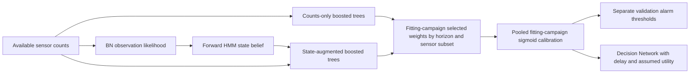
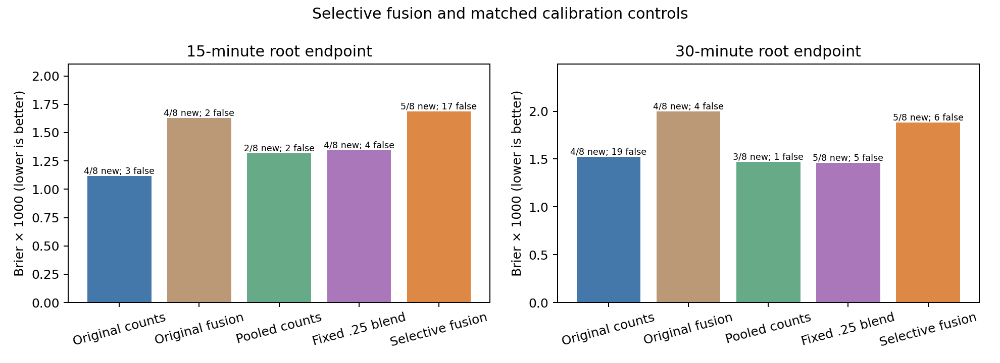

# Selective fusion: completed campaign-validation experiment

The fixed .25 blend is now the [current research preset](../../docs/CURRENT_VERSION.md), with 30-minute warning as its primary use case and further advancements deferred. [Frozen artifacts](../current_version/README.md) preserve its fold predictions, calibrators and thresholds. Choosing that development preset after inspecting results does not change the adaptive primary result below.

**Primary result:** selective fusion gives 5/8 timely 15-minute root warnings and 17 false episodes, versus 4/8 and 3 for original calibrated counts-only. Mean Brier changes from 0.0011185 to 0.0016856 (-50.7% improvement; negative means worse). The stated warning target is not met.

Under the same new calibration procedure, counts-only gives 2/8 warnings, 2 false episodes and Brier 0.0013168. This is the controlled reference for assessing the additional BN/HMM contribution. Neither comparison establishes a previously unpublished architecture or superiority over complete published systems.

This round was specified after inspecting the previous failed blends and confirmation model. Every AIT campaign and CAM proxy was already known. Nested fitting exclusion prevents direct test-label fitting, but does not make repeatedly inspected test cases an independent confirmation set. All six fixed variants and previous negative results are retained.

## Implemented pipeline

For each outer split, six campaigns fit predictors/selection/calibration, the next campaign chooses alarm thresholds, and one campaign is scored. Each of the six fitting campaigns obtains base and state-model forecasts from predictors fitted to the other five. Within those five, augmented training features use state models fitted to four campaigns. Vocabularies and state fitting exclude the held forecast campaign. Existing six-campaign outer expert raw forecasts are preserved exactly.

For each sensor subset and horizon, choose a raw blend weight from {0,.1,.25,.5,1} using the mean six-campaign held-out Brier normalized by counts-only Brier plus .01 times the weight. Calibration follows selection, using those six fitting-campaign predictions with equal total weight per campaign. Sigmoid C=1 and all tree settings are fixed. A negative fitted slope is replaced by the weighted target prior. Monotonicity repair operates along forecast horizons, never through future time.

Weights and calibrators do not use the outer validation or test labels. Thresholds still use the separate single outer validation campaign, exactly as in the reference protocol. Held fitting predictions are reused for choosing weights and fitting final calibrators; five-campaign fitting forecasts versus six-campaign application can shift distributions. Weight selection scores individual raw horizons before the joint monotonicity repair and calibration; those downstream operations may change the error. These remain limitations, so fitting-criterion improvement is not a guarantee about final test forecasts.

The public `predict_selective` API combines actual fitted branches, returns state belief and modeled expected losses, and recommends a Decision Network action without executing it. It retains explicit no-sensor abstention. Static availability is declared, not inferred from measured heartbeats.

## Common full-input comparisons

All tables use successful-root endpoints, strict warning episode starts, and the same validation budget of one false episode per 24 negative hours with at most five negative warning minutes. This budget is a validation constraint, not a guaranteed test alarm rate. Lower Brier and higher AP are better. Root scoring is a sensitivity rescore of models trained for scheduled escalation.

### 5-minute forecasts

| Model | Mean Brier | Mean AP | Timely new warnings / 8 | False episodes | Negative warning minutes |
|---|---:|---:|---:|---:|---:|
| Raw counts-only | 0.0007932 | 0.3190 | 0 | 4 | 15 |
| Raw selective fusion | 0.0008883 | 0.4041 | 0 | 0 | 0 |
| Pooled-calibrated counts-only | 0.0007489 | 0.3190 | 0 | 4 | 15 |
| Pooled-calibrated BN/HMM state + counts | 0.0012013 | 0.4223 | 1 | 2 | 8 |
| Pooled-calibrated fixed .25 blend | 0.0008140 | 0.3808 | 0 | 9 | 56 |
| Pooled-calibrated selective fusion | 0.0010715 | 0.4041 | 0 | 0 | 0 |

Selective fusion versus matched pooled counts: Brier improvement -43.1%; new warnings 0 → 0; false episodes 4 → 0. A warning gain paired with larger alarm burden or worse probability error is a tradeoff.

### 15-minute forecasts

| Model | Mean Brier | Mean AP | Timely new warnings / 8 | False episodes | Negative warning minutes |
|---|---:|---:|---:|---:|---:|
| Original calibrated counts-only | 0.0011185 | 0.7177 | 4 | 3 | 29 |
| Original duration/tree fusion | 0.0016302 | 0.6830 | 4 | 2 | 28 |
| Raw counts-only | 0.0013603 | 0.7213 | 2 | 2 | 28 |
| Raw selective fusion | 0.0014739 | 0.6578 | 5 | 13 | 97 |
| Pooled-calibrated counts-only | 0.0013168 | 0.7089 | 2 | 2 | 28 |
| Pooled-calibrated BN/HMM state + counts | 0.0022515 | 0.6826 | 3 | 8 | 120 |
| Pooled-calibrated fixed .25 blend | 0.0013437 | 0.6539 | 4 | 4 | 40 |
| Pooled-calibrated selective fusion | 0.0016856 | 0.6372 | 5 | 17 | 90 |

Selective fusion versus matched pooled counts: Brier improvement -28.0%; new warnings 2 → 5; false episodes 2 → 17. A warning gain paired with larger alarm burden or worse probability error is a tradeoff.

### 30-minute forecasts

| Model | Mean Brier | Mean AP | Timely new warnings / 8 | False episodes | Negative warning minutes |
|---|---:|---:|---:|---:|---:|
| Original calibrated counts-only | 0.0015254 | 0.8320 | 4 | 19 | 69 |
| Original duration/tree fusion | 0.0019966 | 0.7705 | 4 | 4 | 21 |
| Raw counts-only | 0.0013554 | 0.8325 | 3 | 18 | 68 |
| Raw selective fusion | 0.0016482 | 0.8157 | 5 | 7 | 107 |
| Pooled-calibrated counts-only | 0.0014685 | 0.8312 | 3 | 1 | 5 |
| Pooled-calibrated BN/HMM state + counts | 0.0023517 | 0.7523 | 4 | 8 | 145 |
| Pooled-calibrated fixed .25 blend | 0.0014606 | 0.8275 | 5 | 5 | 33 |
| Pooled-calibrated selective fusion | 0.0018823 | 0.7662 | 5 | 6 | 115 |

Selective fusion versus matched pooled counts: Brier improvement -28.2%; new warnings 3 → 5; false episodes 1 → 6. A warning gain paired with larger alarm burden or worse probability error is a tradeoff.

## Fixed .25 blend: a conditional 30-minute positive result

This control was specified before scoring, rather than added after inspecting the adaptive selector. It combines 75% raw counts-only risk and 25% raw BN/HMM-state augmented risk, then applies the pooled fitting-campaign calibrator. It keeps substantive state-model input in every fold. The adaptive selective variant remains the primary result; this control is a separately identified exploratory finding.

| Model | Mean Brier | Mean AP | Timely new warnings / 8 | False episodes | Negative warning minutes |
|---|---:|---:|---:|---:|---:|
| Original calibrated counts-only | 0.0015254 | 0.8320 | 4 | 19 | 69 |
| Original duration/tree fusion | 0.0019966 | 0.7705 | 4 | 4 | 21 |
| Pooled-calibrated counts-only | 0.0014685 | 0.8312 | 3 | 1 | 5 |
| Pooled-calibrated fixed .25 blend | 0.0014606 | 0.8275 | 5 | 5 | 33 |

Against original counts-only, this control gives 5/8 versus 4/8 timely warnings, 5 versus 19 false episodes and 4.25% lower mean Brier. Mean AP is 0.8275 versus 0.8320. Against matched pooled counts, the blend recovers two additional timely cases, but false episodes rise from 1 to 5; its Brier gain is only 0.54%. Much of the probability gain versus the original model therefore comes from calibration. Original duration fusion has fewer false episodes than this blend, so complete pipeline superiority is not established.

The aggregate false-episode reduction versus original counts depends on wheeler, where the original model produces 17 episodes. Excluding that case, original counts has two false episodes and the fixed blend has five; the direction reverses. The additional timely case relative to original counts is santos. This supports a limited warning/probability tradeoff, not a large robust all-condition gain.

## Calibration recovery versus an actual fusion gain

| Horizon | Earlier state-model Brier | Pooled state-model Brier | Relative improvement |
|---|---:|---:|---:|
| 5 min | 0.0036992 | 0.0012013 | +67.5% |
| 15 min | 0.0046083 | 0.0022515 | +51.1% |
| 30 min | 0.0053693 | 0.0023517 | +56.2% |

Both rows apply to the same six-campaign outer state-model raw forecasts. This comparison isolates the new calibration procedure. Recovering from a failed earlier variant is not itself improvement over the strongest counts-only reference. The pooled-counts ablation separates calibration gains from state fusion.

## Actual BN/HMM contribution

| Test campaign | Weights at 1 / 2 / 5 / 10 / 15 / 30 min | Changed raw minutes at 15 / 30 min |
|---|---|---:|
| fox | 0 / 0.1 / 0.25 / 0.25 / 0.25 / 0.5 | 5137 / 5143 |
| harrison | 0.5 / 0.5 / 0.5 / 0.25 / 0.1 / 0.5 | 6307 / 6307 |
| russellmitchell | 0 / 0 / 0 / 0 / 0.1 / 0.5 | 4392 / 4617 |
| santos | 1 / 1 / 1 / 1 / 1 / 1 | 5069 / 5069 |
| shaw | 0.1 / 0 / 0.1 / 0.1 / 0.1 / 0.25 | 6530 / 6661 |
| wardbeck | 0 / 0 / 0 / 0 / 0 / 0 | 0 / 0 |
| wheeler | 0 / 0.25 / 0.25 / 0.1 / 0.1 / 0 | 6862 / 944 |
| wilson | 1 / 0.5 / 1 / 0.25 / 0.5 / 0.5 | 6499 / 6499 |

Unit 1 BN likelihood and Unit 2 causal HMM states feed the augmented branch; Unit 3 uses the fused onset distribution in delayed-action expected loss. Inner-fit tree audits document actual state-feature splits. Zero weights mean no direct state contribution for that horizon, although monotonicity repair can propagate a lower-horizon contribution upward. Computing a diagnostic alone is not an improvement. `metadata.json` records exact weights and changed prediction minutes for every subset.

## Alarm-budget sensitivity

| Horizon | Budget / 24h | Original counts new / false | Pooled counts new / false | Selective fusion new / false |
|---|---:|---:|---:|---:|
| 15 min | 0 | 3 / 2 | 1 / 1 | 4 / 9 |
| 15 min | 0.25 | 4 / 2 | 2 / 1 | 4 / 9 |
| 15 min | 1 | 4 / 3 | 2 / 2 | 5 / 17 |
| 15 min | 4 | 4 / 3 | 2 / 2 | 5 / 17 |
| 30 min | 0 | 4 / 2 | 3 / 1 | 5 / 6 |
| 30 min | 0.25 | 4 / 2 | 3 / 1 | 5 / 6 |
| 30 min | 1 | 4 / 19 | 3 / 1 | 5 / 6 |
| 30 min | 4 | 4 / 19 | 3 / 1 | 5 / 6 |

## Campaign dependence and paired differences

| 30-min model, excluding wheeler | New warnings / 7 | False episodes |
|---|---:|---:|
| Pooled-calibrated counts-only | 3 | 1 |
| Pooled-calibrated fixed .25 blend | 5 | 5 |
| Pooled-calibrated selective fusion | 5 | 6 |

Eight related campaigns, overlapping fitting sets and prior outcome inspection limit uncertainty estimates. Paired differences and descriptive bootstrap intervals are in `paired_comparisons.json`; they are not confirmatory significance claims.

## Sensor subsets at 15 minutes

| Available sensors | Pooled counts timely / false | Selective fusion timely / false | Counts Brier | Selective Brier |
|---|---:|---:|---:|---:|
| aminer+suricata+wazuh | 2 / 2 | 5 / 17 | 0.0013018 | 0.0016715 |
| aminer+suricata | 2 / 1 | 3 / 1 | 0.0015018 | 0.0014548 |
| aminer+wazuh | 4 / 1 | 3 / 5 | 0.0012148 | 0.0011820 |
| suricata+wazuh | 0 / 2 | 0 / 7 | 0.0027479 | 0.0027389 |
| aminer | 1 / 3 | 3 / 2 | 0.0016647 | 0.0015869 |
| suricata | 0 / 5 | 0 / 0 | 0.0024661 | 0.0041143 |
| wazuh | 1 / 6 | 1 / 5 | 0.0026499 | 0.0058197 |

This table uses scheduled-onset scoring to retain comparability with earlier outage replays. Both methods use matching static availability, nested fitting forecasts and the same calibration/threshold procedure. Modified availability is a paired stress condition, not a new independent attack.

Without Wazuh, selective fusion produces 3/8 timely scheduled-onset warnings versus 2/8 for pooled counts, at one false episode each. Brier decreases by 3.13% and AP rises from .6613 to .7197, while negative warning duration increases from 19 to 25 minutes. The older availability-specific single-campaign calibrated counts expert already gave 3/8 at one false episode, but with higher Brier (.0016708 versus .0014548) and lower AP (.6661 versus .7197). This is incremental state benefit against matched pooled counts plus improved probability/ranking against the earlier expert, with a warning-duration cost. It is not a large all-condition gain.

## Frozen CAM proxy diagnostic

| Method | 15-min timely warnings / 3 | False episodes | 30-min timely warnings / 3 | False episodes |
|---|---:|---:|---:|---:|
| Raw counts-only | 0 | 0 | 0 | 0 |
| Raw selective fusion | 0 | 0 | 0 | 0 |
| Pooled-calibrated counts-only | 0 | 0 | 0 | 0 |
| Pooled-calibrated BN/HMM state + counts | 0 | 0 | 1 | 0 |
| Pooled-calibrated fixed .25 blend | 0 | 0 | 0 | 0 |
| Pooled-calibrated selective fusion | 0 | 0 | 0 | 0 |

AIT-only fox-fold fitting/selection/calibration and harrison thresholds transfer without CAM tuning. AMiner is absent, Wazuh and Suricata are declared present. These three known outcomes are executed-tactic proxies, not verified successful compromises. At 30 minutes there is only one minute of negative exposure across the records; no daily budget or generalization conclusion follows from zero false episodes.

## Decision Network under the original assumed settings

| Model | Lower cost versus delay-blind / 27 | Higher cost / 27 | Mean assumed improvement |
|---|---:|---:|---:|
| Raw counts-only | 12 | 15 | 0.0007184416 |
| Raw selective fusion | 27 | 0 | 0.001433028 |
| Pooled-calibrated counts-only | 19 | 8 | 0.0007796296 |
| Pooled-calibrated BN/HMM state + counts | 18 | 9 | 0.0002772695 |
| Pooled-calibrated fixed .25 blend | 14 | 13 | 0.0008903138 |
| Pooled-calibrated selective fusion | 12 | 15 | 0.0008093933 |

Damage {10,20,50}, efficacy scales {.5,.8,1} and disruption {.5,1,2} match earlier analysis. These are framewise hypothetical costs and assumed action effects, with no executed defenses or measured prevention. A policy rescore cannot establish effective attack prevention.

## What can be claimed

The numerical comparisons establish only the observed differences under this fixed exploratory protocol. A gain relative to the failed state model is calibration recovery; a gain relative to pooled counts is evidence of incremental state fusion on these cases. Neither implies consistent superiority across metrics, conditions or complete published systems. The selected primary variant is retained regardless of whether another control has a better test result.

Fresh independent campaigns with long no-target intervals, online sensor receipt evidence and verified outcomes remain needed for stronger early-warning claims. Physical response effects remain unmeasured. Conventional weighted fusion and cross-validated calibration do not establish first-ever architecture; the literature limitations in `docs/NOVELTY_AUDIT.md` still apply.

## Reproduce and verify

Run `backend/research/run_selective_fusion.ps1`. Existing AIT caches, audited endpoints and previous raw expert forecasts are prerequisites. Four independent fitting processes each use two numerical threads; `-Workers 1` runs sequentially. Valid caches resume with source/data hashes. No data are fetched and no packages are installed.

Verification passed 33 tests, 280 inner availability fits across 40 distinct five-campaign sets, 56 outer availability settings, 8064 thresholds, 23040 score rows, 9072 assumed decision rows and 432 external rows. Weights, calibrators, forecasts and metrics were independently reconstructed. Hashes are in `reproducibility.json`.

Method references: [official probability calibration guidance](https://scikit-learn.org/stable/modules/calibration.html) and [group-aware cross-validation guidance](https://scikit-learn.org/stable/modules/cross_validation.html). These support established evaluation practices, not an originality claim.
